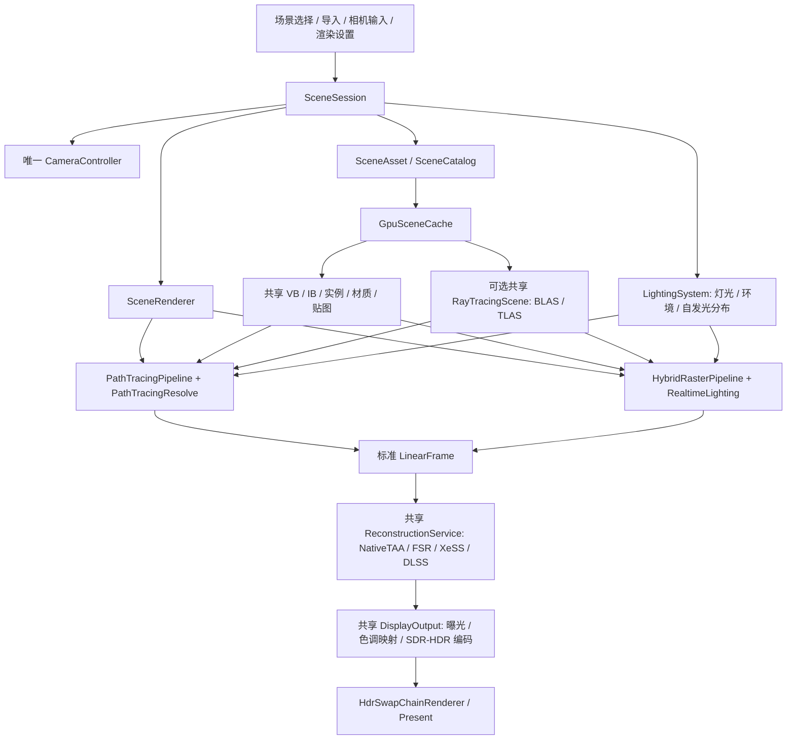
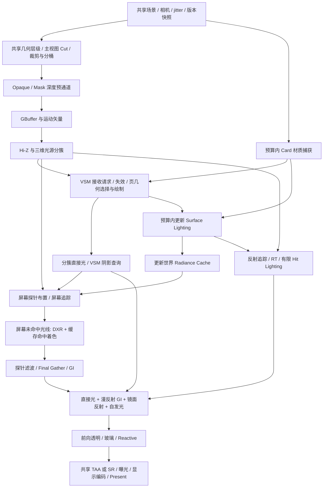

# 现代光栅化、虚拟几何与硬件光追 GI 管线设计

状态：设计提案，尚未实现。日期：2026-10-26。代码基线：`af55fab`。

目标是在现有路径追踪之外增加一个实时混合渲染器：主表面由光栅化确定，间接光和反射参考 UE5 Hardware Lumen 的缓存架构。场景、相机、GPU 场景资源、灯光定义、超分和显示输出抽成共享组件，两条管线只保留各自的可见性与光传输算法。

几何与直接光阴影进一步采用类似 Nanite 的动态无裂缝 LOD，以及类似 UE5 Virtual Shadow Maps 的分页阴影，详细见[虚拟几何、动态无缝 LOD 与 VSM 联合设计](VIRTUAL_GEOMETRY_SHADOWS_DESIGN.md)。该补充设计定义主视图/阴影视图共用的几何层级、VSM 缓存与平滑切换的验收边界。

## 1. 关键决策

| 项目 | 设计选择 |
| --- | --- |
| 主渲染架构 | 不透明物体采用紧凑 GBuffer + Clustered Deferred；透明和玻璃采用 Forward |
| 实时间接光 | 屏幕探针 + DXR 三角形追踪 + Surface Cache + 世界空间 Radiance Cache |
| 反射 | 屏幕追踪优先，屏幕外使用硬件光追；默认读取缓存，质量档允许 Hit Lighting |
| 直接光与阴影 | 分簇处理方向光、点光和聚光；目标采用 VSM clipmap/局部虚拟映射与页缓存；传统阴影作为基线与降级后端；任意屏幕外查询可用 RT 可见性 |
| 共用组件 | 一个 SceneSession、一个 CameraController、一份 GpuScene、一个 ReconstructionService、一个 DisplayOutput |
| 路径追踪 | 保留独立光传输求解器，使用同一份几何、材质、灯光与输出服务，作为参考路径 |
| 几何前提 | 静态 glTF/GLB 与实例化；派生 cluster/group 层级提供动态无裂缝 LOD，主视图、VSM 与 Card 捕获共用；不用 UE5 Nanite 代码作为依赖 |
| 能力分级 | 基础光栅需要 D3D12、SM 6.0、Resource Binding Tier 2；硬件 GI 额外需要 DXR Tier 1.0、SM 6.5 |
| 调度 | 新增通道在宿主的单个 Direct Queue 上录制，使用现有双缓冲 fence 管理生命周期 |

引入间接光缓存后，需要在光照合成前读取完整表面属性，因此这里将最初考虑的 Forward+ 调整为分簇延迟着色。Forward+ 适合基础 PBR 和透明材质；本项目现在优先考虑 GI、反射、调试视图与最终合成之间的数据流。两者的光源分簇算法仍然可以共用。

本文借鉴公开的 Lumen 原理，下面的类名、数据布局、预算和实施顺序均是本项目的设计，不能据此声称已实现 UE5 Lumen 或具有相同的性能、质量与特性。

## 2. 现有代码与需要抽取的边界

| 现有位置 | 当前职责或耦合 | 目标归属 |
| --- | --- | --- |
| [RayTracePass.cs](../DXRDemo/Shaders/RayTrace/RayTracePass.cs) | 场景目录、异步加载、导入提交、相机、灯光设置、追踪、重建均在一个类中 | 场景与控制移至 SceneSession，逐帧编排移至 SceneRenderer，追踪部分保留为 PathTracingPipeline |
| [MainWindow.xaml.cs](../DXRDemo/MainWindow.xaml.cs) | 场景选择、键鼠、导入、曝光和 SR 多处判断 RayTracePass 类型 | 统一控制 SceneSession 与共享渲染设置；算法专属面板读取能力描述 |
| [SceneAsset.cs](../DXRDemo/Scene/SceneAsset.cs) | 已有与渲染算法无关的 CPU 几何、材质、纹理、实例、灯光 | 保留为共享场景输入，不再创建第二套 RasterSceneAsset |
| [CameraController.cs](../DXRDemo/Camera/CameraController.cs) | 已有相机导航和 CameraFrame，但实例由 RayTracePass 持有 | 由 SceneSession 唯一持有，切换管线保留相机姿态 |
| [DxrSceneBackend.cs](../DXRDemo/DXR/DxrSceneBackend.cs) | 私有 SceneGpu 同时持有网格、材质、贴图、BLAS/TLAS 与追踪输出描述符 | 通用 GPU 数据进入 GpuScene；加速结构进入可选 RayTracingScene；通道输出留给各管线 |
| [SuperResolutionRenderer.cs](../DXRDemo/SuperResolution/SuperResolutionRenderer.cs) | 把 NRD、OptiX、玻璃、路径信号转换、SR 和编码混在一起 | 路径降噪与玻璃 resolve 留在 PathTracingResolve；SR 调度抽为 ReconstructionService；编码抽为 DisplayOutput |
| [DxrDevice.cs](../DXRDemo/DXR/DxrDevice.cs) | 包装共享设备却强制检查 DXR，并创建自己的队列 | 通用 RenderDeviceContext 独立查询能力；DXR 检查由 RayTracingScene/追踪管线执行 |
| [HdrSwapChainRenderer.cs](../DXRDemo/Hdr/HdrSwapChainRenderer.cs) | 持有呈现队列、双缓冲、宿主帧纹理与呈现 fence | 保持宿主所有权，向新管线提供借用的 RenderFrameContext |
| [ShaderCatalog.cs](../DXRDemo/Shaders/ShaderCatalog.cs)、[ShaderFactory.cs](../DXRDemo/Shaders/ShaderFactory.cs) | 现有可选渲染器入口及实例缓存 | 注册 ray-trace / raster-pbr 两个轻量入口，引用同一个 SceneRenderer |

现有 `.mesh.gz` Stanford 模型并不是 SceneAsset，增加一个 MeshData → SceneAsset 适配器，让两条管线读取同一场景目录。保留原始球体与软件 BVH 诊断入口，不把它们扩展成第二套应用场景管理。

## 3. 共享组件架构



### 3.1 唯一所有者与生命周期

| 组件 | 职责 | 生命周期 |
| --- | --- | --- |
| SceneSession | 场景目录、当前文档与场景、异步加载/取消、场景提交、相机、太阳/环境/曝光设置 | 应用窗口，独立于所选管线 |
| SceneRenderer | 每帧推进一次相机、采集设置快照、选择管线、调用共享重建/输出 | 应用窗口 |
| GpuSceneCache | 上传一次公共 GPU 场景，提供 mesh offsets、bounds、稳定实例 ID、派生虚拟几何与资源租约 | 设备；场景以租约与 fence 退役 |
| VirtualGeometryRenderer | 共享几何层级遍历、误差选择、裁剪和间接绘制，按用途输出 GeometryCut | 场景派生几何版本；各用途共享数据 |
| RayTracingScene | 引用公共几何构建 BLAS/TLAS，维护材质可见性掩码 | 按需创建，按几何/实例版本更新 |
| LightingSystem | 唯一灯光/环境数据、稳定 LightId、单位与开关语义，环境预处理、自发光三角形分布 | 场景与光照版本 |
| ShadowSystem | 统一阴影查询，调度 VSM 页与预算、传统阴影降级，以及任意位置 RT fallback | 灯光投影/遮挡版本；区别于颜色/强度版本 |
| RealtimeLighting | Surface Cache、屏幕探针、世界探针与反射历史 | 混合管线使用；绑定共享场景版本 |
| ReconstructionService | 能力探测、输入尺寸、jitter、NativeTAA、厂商 SR、有效模式与失败原因 | 应用窗口；切换时重置屏幕历史 |
| DisplayOutput | 一份曝光与 SDR/HDR 编码实现，输出宿主的编码帧纹理 | 设备/输出配置 |
| RenderFrameContext | 命令列表、帧槽、上传切片、描述符切片、retirement fence | 单帧，管线借用 |

ShaderFactory 中的两个入口只负责目录身份和选择 PipelineKind。入口不各自持有 Session/相机/重建器，也不释放借用的服务。SceneRenderer 由 MainWindow 在停止渲染后统一释放一次，避免缓存入口导致重复 Dispose。

公共 GPU 顶点继续使用现有 80 字节 SceneVertex，索引保持 uint，SceneMaterial/TextureBinding 保持一个 CPU/HLSL 契约。原始几何与光追共用原始 VB/IB；自适应光栅、VSM 和 Card 捕获引用同一源顶点，增加派生层级索引与 metadata。首期不在每次选择 LOD 时重建 BLAS。缓冲状态允许各自所需的只读用途，纹理读取明确声明 Pixel/NonPixelShaderResource，不能沿用当前只有 NonPixelShaderResource 的假设。

BLAS/TLAS 也共用，但它们是 GpuScene 的可选扩展。不能为了纯光栅启动而提前构建。当前静态场景只在几何/实例变化时构建，不照搬动态引擎逐帧重建 TLAS 的成本。不同光线用途使用统一定义的实例掩码，已有玻璃阴影掩码迁移时保留其语义。

### 3.2 场景事务与线程规则

1. 后台解析 glTF、解码纹理并形成候选 SceneDocument，带加载请求序号和取消令牌。
2. 渲染线程准备候选 GpuScene；可选 RT 管线还需准备对应 RayTracingScene。上传资源存活到提交 fence 完成。
3. CPU 场景、GPU 租约和默认相机一起提交为新的 SceneSnapshot。失败、取消或旧请求晚到均保留原场景。
4. 同一个 SceneAsset 切换管线时复用公共资源；如果首次启用硬件 GI，需要补建加速结构，不能重新导入或重新上传全部贴图。管线激活也是事务，所需资源准备成功后才切换，有错误则保留原有效管线并报告原因。
5. UI 线程只发布命令/设置。创建 PSO、提交 GPU 工作、切换有效管线和释放 GPU 资源都在渲染线程执行。

### 3.3 标准帧输出

管线交给公共后处理的是 `LinearFrame`，不是 PbrSignals，也不是已做 PQ/sRGB 编码的图像：

| 字段 | 统一语义 |
| --- | --- |
| Color | 当前输入分辨率的线性 Rec.709 HDR，未做显示曝光，FP16 RGBA |
| Depth | 统一的有限远平面反向 Z，near=1、far/sky=0；同时携带 near/far/FOV 与有效表面标记 |
| Motion | 当前 → 前一帧，单位为输入像素，排除 jitter，纹理 Y 向下，RG16_FLOAT |
| NormalRoughness | 世界空间着色法线与 perceptual roughness；按后处理需要提供 |
| Reactive | 透明、折射和无法可靠重投影区域的响应遮罩 |
| Camera / Jitter | 当前与上一帧无抖动矩阵、当前 jitter 的输入像素偏移，以及渲染帧序号 |
| Revisions | Scene、Geometry、Material、Lighting、CameraCut、Pipeline、Output 的版本；几何表示切换另有局部 mask，阴影投影另有 ProjectionEpoch |
| ResolvePolicy | 原生输出是否需要 TAA、是否为路径参考累计、是否允许厂商重建 |

常规 PathTracingPipeline 经路径专属降噪、stable planes 与玻璃 resolve 后转换到该契约；HybridRasterPipeline 经 GI/反射重建和透明合成后输出同一契约。NRD 与 OptiX 的输入保留为专属信号，不强行让光栅伪造这些信号。

DLSS Ray Reconstruction 依赖路径信号，作为共享 ReconstructionService 的可选扩展端点；启用时 PathTracingPipeline 提供未降噪的原始 radiance 与额外 guides，旁路 NRD/OptiX/自定义时间预滤波，由 RR 负责重建。混合管线首期只使用 DLSS SR，既不伪造 RR 输入，也不创建第二份 DLSS 运行时封装。

### 3.4 UI 与设置只保留一套

场景、导入、相机、太阳、环境、曝光、HDR、SR 模式和比例都控制共享对象。路径专属保留 SPP、反弹次数、NRD/OptiX；混合专属提供 LOD 屏幕误差、VSM 页/软阴影预算、GI 预算、反射质量和缓存调试视图。

持久化保留稳定 `ShaderId`，新增各管线专属设置区。已有公共字段迁移一次，不复制出 RasterCamera、RasterSceneIndex 或 RasterRenderScale。使用 `RequestedMode` / `EffectiveMode` 区分用户选择与当前能力：例如已选 DLSSD 时切到光栅，实际使用可用的 DLSS SR，否则 NativeTAA；切回路径追踪可恢复原请求。界面报告有效模式和原因。

切换不改变当前模型、相机姿态和灯光设置；只重置有关的屏幕历史。非活动管线的持久资源允许缓存，受显存预算控制，不能由 ShaderFactory 无限保留两套全部中间纹理。

## 4. Hardware Lumen 借鉴范围

Epic 的公开说明将屏幕追踪、Surface Cache 与硬件三角形追踪组合起来；Surface Cache 以 Cards 保存表面信息并分帧更新光照。公开的 Final Gather 介绍进一步使用屏幕辐射缓存和世界空间辐射缓存复用稀疏光线。[Lumen 技术细节](https://dev.epicgames.com/documentation/en-us/unreal-engine/lumen-technical-details-in-unreal-engine)、[Epic 技术文章](https://www.unrealengine.com/tech-blog/unreal-engine-5-goes-all-in-on-dynamic-global-illumination-with-lumen?lang=en-US)

对应到本项目，明确采用以下分工：

| 层级 | 回答的问题 | 本项目表示 |
| --- | --- | --- |
| 几何可见性 | 光线击中了哪里？ | 当前帧深度/Hi-Z，失败后查询共享 BLAS/TLAS |
| 表面缓存 | 命中表面是什么材质，向外发出多少漫反射光？ | Cards 参数化、材质 atlas、漫反射辐射亮度 atlas |
| 屏幕探针 | 当前可见表面从哪些方向收到光？ | 低分辨率、几何自适应的方向辐射探针 |
| 世界辐射缓存 | 屏幕外/远处方向的光如何稳定复用？ | 相机附近的稀疏多级空间探针，保存方向光照与可见性信息 |
| 反射 | 当前观察方向看见什么？ | 屏幕追踪、RT、缓存命中着色及有限 Hit Lighting |

Surface Cache 存在物体表面，Radiance Cache 存在空间中；不能把二者合并成一张无几何约束的“GI 贴图”。硬件光追只是求交方式，也不能替代这两类缓存。

Lumen 的默认缓存着色和高质量 Hit Lighting 是质量/成本选择；后者需要在命中点计算材质并发射阴影光线，成本更高。[Epic 硬件光追说明](https://dev.epicgames.com/documentation/en-us/unreal-engine/hardware-ray-tracing-in-unreal-engine)

本项目首先围绕 Kitchen、Bistro、Rainy Corner 的静态三角形场景实现这条架构，并将虚拟几何 LOD 与 VSM 纳入目标。软件距离场 Lumen、World Partition、体积 GI 和复杂动画暂不纳入。基础光栅可使用环境照明降级模式；该模式明确显示 GI 不可用，不宣称具有 Lumen 的屏幕外间接光。

## 5. 混合管线逐帧流程



图中的依赖在首期按单队列顺序录制。漫反射 GI 的屏幕追踪读取独立的 ScreenDiffuseRadiance：当前 emission + 漫反射直接光 + 上一帧经验证的漫反射间接光，不混入视角相关镜面项。反射屏幕追踪读取经验证的不透明出射颜色；两者均禁止采样尚未生成的当前最终合成图形成反馈环。

### 5.1 光栅主表面与直接光

- 基线先按实例 bounds 做视锥裁剪，随后由共享虚拟几何层级按屏幕误差生成合法 Cut；按 OPAQUE、MASK、BLEND、Transmission、双面与镜像变换分桶，复用源顶点、派生索引并使用间接绘制。
- 深度采用 D32_FLOAT、clear=0、GREATER_EQUAL。不透明 GBuffer 使用只读深度和相同投影，避免深度与材质采样位置不一致。
- Hi-Z 根据用途保留明确的归约语义；反向 Z 用于保守遮挡时采用区域最远遮挡深度的 min 归约。含天空/空洞的区域不能当作完整遮挡，屏幕光线追踪按同一深度约定比较和验证厚度。
- MASK 的 alpha cutoff、UV 变换和采样语义在深度、GBuffer、阴影与 RT any-hit 中一致；BLEND/玻璃不写入不透明深度。
- Normal 使用逆转置；tangent handedness 计入负缩放。统一 row-vector CPU/HLSL 约定，HLSL 矩阵显式声明 row_major；DXR 的 3×4 实例描述另做显式布局转换。
- 分簇起点为 16×16 输入像素、24 个对数 Z 切片，按实际 near/far 建立体积。使用全视锥分簇，使透明物体也能查询；首期不按不透明 tile 深度排除透明层需要的灯光。
- 光源列表使用 count → prefix sum → fill；超过索引预算的 cluster 标记 overflow，并回退遍历局部光源保证正确性，同时报告统计，不能静默丢灯。
- 直接光共用 glTF 物理单位与 GGX/Smith/Fresnel 材质函数。目标阴影后端采用方向光 VSM clipmap、点光六面/聚光单映射的虚拟 mip 与页缓存；预算不足时优先降低精度并保留粗覆盖，报告有效后端和 fallback。

M1 基线用稳定 CSM 和传统局部阴影验证直接光；作为同一个 ShadowSystem 的对照/降级后端，不另建一套 UI 或灯光数据。VSM 的分页、clipmap、几何联动、PCF/SMRT 与失效规则见[联合设计第 5 节](VIRTUAL_GEOMETRY_SHADOWS_DESIGN.md#5-vsm直接光阴影的目标实现)。光栅阴影与 RT 可见性共用遮挡材质语义，首期不包含彩色玻璃焦散阴影。

### 5.2 Surface Cache：先解决覆盖，再解决更新

**表示与构建。** 每个 mesh 在局部空间生成 Card 描述，在后台预处理；实例共用 Card 布局，但光照 atlas 分配按实例区分。初始方向可取局部 ±X/±Y/±Z，复杂凹面需要按连通分量/法线簇增加捕获区域。不能认为六个包围盒方向天然覆盖厨房内部。

每张 Card 用正交光栅捕获 base color、漫反射反照率、几何/着色法线、深度、emission 和材质标记。重叠层无法被单次捕获表示时增加 Card 或划分捕获区域；不修改原场景的可见几何。版本缓存键包含 mesh 数据、材质和 Card 构建算法版本；首次导入可后台生成，打包场景可离线预生成。

**命中查询。** 由 RT 命中的 InstanceId、PrimitiveId、barycentric 找到局部点与法线，选择投影方向相容的 Card，再做捕获深度和表面法线匹配。atlas 需要 tile padding、边缘扩展和受控 mip，不能直接在不同 Card 之间双线性混合。没有有效覆盖时回退到有预算的 Hit Lighting；预算耗尽时返回低置信度的世界探针估计并标记调试，不能把洞解释成无遮挡天空。

**缓存内容。** 材质数据与光照数据分开，光照只缓存近似视角无关的漫反射出射辐射亮度：

```text
L_surface = L_emissive + diffuseReflectance / pi * (E_direct + E_indirect)
```

镜面项不写进这张漫反射辐射缓存。金属的 diffuseReflectance 趋近零，不能错误地把金属 base color 当作漫反射；unlit 采用自身颜色的明确出射语义。

**直接光更新。** 按 Card/page 分配重要光源，并通过 ShadowSystem 为捕获表面请求低频 VSM 覆盖或使用 HWRT 阴影查询；不能假定主视图深度已请求屏幕外所需的页。太阳、punctual 参数与主表面使用同一 LightingSystem。小而亮的自发光面通过共享 emitter 分布增加重要性采样，采样 PDF 与命中发光表面的估计保持一致。

**多次反弹。** 第一版先验证一跳间接光；之后让 page 的间接辐照度从上一版本的 Surface Lighting/世界缓存估计，采用双版本读写与分帧迭代。不能在同一轮读写同一张 radiance atlas，也不能把“跨帧迭代”当作已经证明无限反弹收敛。需要能量、稳定性与亮度收敛的实测。

**调度。** 用可见性反馈、屏幕外光线命中次数、page age 和版本变更决定优先级。新可见页、光照改变区域优先，其余按预算轮转；材料捕获与光照更新分别计时。atlas 设定容量与 LRU；新分配/复用的 tile 先清空 validity，避免读取另一物体的旧光照。

### 5.3 Screen Probe Gather 与世界 Radiance Cache

屏幕探针先按 16×16 像素网格布置，在深度/法线断层追加探针。一个格子不能只有一个跨越前景与背景的探针；样本保存接收表面、法线、正 view depth、材质与历史置信度。

每个探针用八面体方向图保存入射 radiance 和命中距离，首个验证配置为 8×8 个方向。方向采样可由历史能量引导，但保留覆盖整个有效域的采样概率和正确 PDF。屏幕追踪经 Hi-Z 验证厚度与方向；屏幕外、遮挡不确定或历史失效时进入 HWRT，不返回零来冒充有效估计。

HWRT 路径为“求交 → 读取 Surface Lighting，缺失时 Hit Lighting → miss 时采样环境”。首期复用现有 DXR 1.0 / lib_6_5 的 DispatchRays；RayQuery 作为 DXR 1.1 / SM 6.5+ 的后续优化，按设备查询和测量决定，不强制 SM 6.9 或 SER。

世界缓存采用围绕相机的稀疏多级探针网格；空间探针保存方向 radiance、距离/可见性统计、年龄、场景与光照版本。移动相机时以整格滚动，失效进入的新区域，不整体重置。插值同时考虑可见性、接收点与法线关系，拒绝跨墙混合，并提供 probe relocation/invalid 标记，避免室内漏光。

世界缓存更新只能读取已完成的上一版本 Surface Lighting/世界缓存，再发布当前版本；Surface 间接光更新可消费已完成的世界缓存版本。缓存缺失回退也只读已完成且有效的版本，禁止 Surface → World → Surface 在同一轮递归读写。冷启动没有有效结果时标记低置信度，优先安排实际追踪；不能用未初始化历史补齐。

近处命中优先走几何/Surface Cache；远处方向可以使用世界缓存，按距离和置信度切换。屏幕缓存与世界缓存都保存入射光，Final Gather 才与全分辨率表面 BRDF 结合，避免把不同颜色物体之间的 irradiance 与已乘反照率颜色混用。

硬件 GI 打开时，环境光由 miss/探针承担遮挡后的贡献，不再额外叠加一份全屏 IBL 漫反射。GTAO 只可作为有限范围的接触细节修正，默认不再全量乘一次 AO，防止重复遮蔽。

### 5.4 反射与透明

反射按 roughness 分配采样预算：低粗糙度需要方向准确的 RT 反射，中等粗糙度重投影/空间重建，高粗糙度可使用探针与预过滤环境的近似。屏幕追踪先找可验证命中，失败后追踪共享三角形场景；屏幕外物体必须可见于反射。

默认反射命中读取缓存的漫反射出射光。高质量 Hit Lighting 在命中点重新求材质和直接光的可见性，并补充缓存间接光；该路径保留预算和最大深度，第一版不尝试镜面中的递归镜面。缓存近似与 Hit Lighting 各有调试对照，不能把缓存模式描述成物理准确镜面。

BLEND 首期按实例/primitive 后到前排序，使用预乘 alpha、只读不透明深度；相交透明几何的排序误差记录为限制。Transmission 与 alpha blend 是独立语义：玻璃首期采用 Fresnel、IOR、厚度吸收和屏幕背景折射，屏幕外反射可使用 RT。玻璃的最近有效表面提供运动/响应信息，不覆盖用于 SR 的不透明背景深度约定。

透明物体的低频间接光来自世界探针。多层实体折射、嵌套介质与焦散仍由现有路径追踪提供；不把这部分误列为首期混合光栅已具备的能力。glTF 的 alpha 与 transmission 语义依据 [glTF 2.0](https://registry.khronos.org/glTF/specs/2.0/glTF-2.0.html) 和 [KHR_materials_transmission](https://github.com/KhronosGroup/glTF/tree/main/extensions/2.0/Khronos/KHR_materials_transmission)。

### 5.5 合成的能量边界

```text
Color = Emission
      + AnalyticDirectLighting
      + DiffuseBRDF × GatheredIndirectIrradiance
      + IndirectSpecularReflection
```

直接光是太阳和 punctual 的直接贡献，GI 是间接入射光；缓存的 L_surface 供二次命中读取，不能直接当作当前像素的额外一层光。小发光面在探针中的 NEE 与方向采样命中需要匹配权重，避免计算两次。关闭“外加光照”时同时关闭外加太阳与环境的所有缓存贡献，保留模型灯光与自发光。

## 6. 公共重建、时间历史与输出

ReconstructionService 只接收标准 LinearFrame，在一次调用中选择 NativeTAA、厂商 SR 或 passthrough。NativeTAA 用于需要抗锯齿的原生光栅输出；厂商 SR 自带时间重建，不预先叠加一次 NativeTAA。路径降噪、GI 探针滤波属于信号重建，可以先于 SR，但不是第二套全屏 TAA。路径参考累计模式保持其原有累计语义。

有限反向 Z 的约定为正 view depth `z`、近远平面 `n/f`：

```text
d_reverse = (n * f / z - n) / (f - n)
motion = previousUnjitteredPixel - currentUnjitteredPixel
```

浮点反向 Z 的精度动机见 [NVIDIA 深度精度说明](https://developer.nvidia.com/blog/visualizing-depth-precision/)。

现有 [NativeReconstruction.cs](../DXRDemo/SuperResolution/NativeReconstruction.cs) 的 Frame 没有深度约定字段，原生桥接创建 FSR/DLSS 时也没有启用反向深度标志。第一步在共享适配层转成 SDK 当前使用的常规 R32_FLOAT 深度，携带真实 near/far/FOV，尽量保持现有 ABI；后续若原生支持反向 Z，使用显式 DepthConvention 和上下文配置版本，不能只替换纹理。

jitter 由共享服务产生，调用方使用明确的像素偏移与投影变换；光栅和 ray-primary 使用各自的投影/逆投影，不能直接复制现有 `JitterX = -jitter.X`。每个厂商适配器按 SDK 约定转换。必须验证“相机静止但 jitter 变化时，motion≈0”，以及 Y 翻转和 50% 比例下的像素单位。[FSR 的深度与运动输入契约](https://gpuopen.com/manuals/fidelityfx_sdk/techniques/super-resolution-upscaler/)

| 变化 | 屏幕 TAA/SR/GI/反射历史 | Surface 材质缓存 | Surface/世界光照缓存 |
| --- | --- | --- | --- |
| 正常相机移动 | 重投影与局部拒绝 | 保留 | 保留，更新可见反馈/滚动新区域 |
| 相机 cut / 切换管线 | 重置 | 保留 | 版本相同可保留，提高过期页刷新优先级 |
| 太阳/环境/灯光改变 | 失效有关光照历史 | 保留 | 按 LightingRevision 失效或降置信度，并提高更新预算 |
| 材质/几何改变 | 失效受影响区域 | 重新捕获有关页 | 失效有关页/探针；几何变化还更新 AS |
| 主视图几何 LOD 切换 | 局部 representation-change mask 拒绝有关历史 | 使用独立捕获 Cut 时保留 | 只拒绝不匹配表面，不整体清空；VSM 按自身几何依赖决定是否重绘 |
| 导入新场景 | 全部重置 | 换 SceneEpoch | 换 SceneEpoch |
| 分辨率/SR 算法改变 | 重建有关屏幕资源 | 保留 | 保留 |
| 显示曝光/HDR 改变 | 场景线性历史保留 | 保留 | 保留；只重配显示输出 |

生成并提交 GPU 的帧序号推进 jitter 和历史；DXGI 因忙碌未呈现不等于 GPU 帧未执行，不能按成功 Present 次数回滚时间状态。

DisplayOutput 共用现有项目的色调映射与编码行为，避免接入时顺带改变参考图：在线性光照/重建之后统一应用曝光，随后 SDR 映射/编码，或亮度映射、Rec.709 → Rec.2020、PQ。HDR 宿主只复制已编码帧，不再次施加传递函数。

## 7. GPU 资源、队列与性能预算

### 7.1 基础输入资源

| 资源 | 格式/用途 |
| --- | --- |
| Depth | R32_TYPELESS 资源，D32_FLOAT DSV、R32_FLOAT SRV |
| BaseColorAO | R8G8B8A8_UNORM_SRGB 视图；RGB 为线性颜色经硬件编码存储，A 为材质 AO |
| ShadingNormalRoughnessMetallic | RGBA16_FLOAT；八面体法线 XY、roughness、metallic |
| GeometricNormal | RG16_SNORM；几何法线，用于探针起点偏移与几何拒绝 |
| EmissiveFlags | RGBA16_FLOAT；RGB HDR 自发光，A 为少量材质/有效表面标记 |
| Velocity | RG16_FLOAT，输入像素单位 |
| SceneColor | RGBA16_FLOAT，合成后的线性 HDR |
| Reactive | R8_UNORM |
| VSM | 常规 light-space Z 的物理深度页池，虚拟页表与几何依赖另计 |
| Surface Cache | page 化材质 atlas + 双版本光照 atlas，容量可配置 |
| Probe 数据 | 方向 radiance、距离、置信度/年龄，独立于最终图像的时间历史 |

不存全分辨率世界坐标，使用深度和逆抖动矩阵重建。基础资源格式累计约 41 bytes/输入像素；这不含光照中间结果、Hi-Z、探针、缓存、SR SDK 和模型。

作为显存规划示例，当前基础输入在 1080p 约 81 MiB，在 4K 约 324 MiB；两份 HDR+深度时间历史分别约 47/190 MiB；现有两张 4K RGBA16 编码输出约 127 MiB。VSM 的起始物理池按 2048 个带 guard 的 128² 页估计约 136 MiB，详见联合设计；M1 的 4×2048² D32 CSM 基线约 64 MiB，两种后端按选择计费。几何派生数据、缓存和 SDK 还有独立预算，4K 原生不能沿用 1080p 的显存假设。

Surface atlas 建议从总计 256 MiB 的材质/双版本光照预算开始，世界缓存从 64 MiB 开始做压力验证。这些是设计起点，尚无设备测量。预算不足优先降低 page 分辨率、探针更新数量或输入比例，并报告降级；不能只降低 ray count 而让 atlas 无限增长。

### 7.2 单队列与宿主衔接

当前多个 DXR/重建后端各自 `SignalAndWait()`。新增管线改为借用宿主 Direct Queue 的 RenderFrameContext，将光栅、GI dispatch、SR、编码和全屏输出按顺序录制，不每个 pass 提交并等待。

IShaderPass/IHdrShaderRunner 保留兼容入口；新增原生命令录制接口供 SceneRenderPass 使用。HdrSwapChainRenderer 在渲染线程识别并调用该接口，统一提交与 signal。迁移中的旧追踪后端可暂时保留原同步提交，作为适配器接入标准帧；之后逐步把 Trace/Resolve 改为录制接口。

必须处理一个现有细节：`GpuDiagnostics.Draw()` 通过 ComputeSharp 自己的执行路径绘制 HUD，不能在尚未提交的原生命令列表之间直接调用。首期原生分支把诊断数据显示到 WinUI 文本，GPU 图像 HUD 等有同队列录制实现后再接入；保留现有路径的 HUD 行为。

每帧槽独占 CPU 写入的常量切片、动态描述符、查询/readback 区。只在槽 fence 完成后重用。GPU 顺序访问的临时图像可在同队列上复用，历史显式 ping-pong；场景/尺寸资源退役等待最后引用它们的 fence。SDK 调用后重新绑定所需 root signature、PSO 和 descriptor heaps，不假设外部代码保留绑定。

资源状态与 UAV 顺序由轻量 PassScheduler 根据每个 pass 的输入/输出声明处理：深度写入/只读、RTV→SRV、UAV 生产→消费、间接参数→INDIRECT_ARGUMENT 均显式表达。开始采用现有 resource barrier API；首期只做状态/依赖与生命周期追踪，不引入复杂内存 alias 或多队列调度。[D3D12 队列同步说明](https://learn.microsoft.com/en-us/windows/win32/direct3d12/user-mode-heap-synchronization)

### 7.3 测量方式

各自记录 GeometrySelect、Raster/GBuffer、VsmPageRequest/Depth/Projection、Direct、CardCapture、SurfaceLighting、WorldCache、ProbeTrace/Gather、Reflections、Transparency、SR/Output 的 GPU 时间；记录所选几何量、CPU 提交、几何/VSM overflow、缓存命中率、无覆盖比例、page age、光线数、AS 构建次数、显存和实际呈现帧率。

建议先以 1080p 输入 → 4K 输出建立 60 Hz/16.67 ms 的整帧优化目标；这是目标，不是承诺。首轮拆分预算可用：主表面+直接光 4 ms，GI+反射 6 ms，透明+SR+输出 3 ms，余量约 3.7 ms。缓存捕获和 AS 更新也计入总帧，单帧超预算必须可见。测试同时覆盖静止、持续移动、突然转身、光照改变和首次导入。

8×8 方向、16×16 探针网格在 1080p 已约有 52 万条方向样本，仍不含自适应探针与反射。必须允许时间分摊、历史引导与独立 ray budget，不能把低分辨率探针误认为几乎无成本。

## 8. 模块与文件组织建议

```text
DXRDemo/
  Rendering/
    SceneRenderer.cs              # 唯一逐帧编排器
    SceneRenderPass.cs            # catalog 的轻量兼容入口
    RenderDeviceContext.cs        # 通用设备能力与借用的宿主设备
    RenderFrameContext.cs         # 命令录制、帧槽、上传与描述符
    GpuSceneCache.cs               # 一份公共 GPU 场景
    RayTracingScene.cs            # 两种硬件光追用途共用的 BLAS/TLAS
    LinearFrame.cs                # 公共后处理输入
    PassScheduler.cs              # pass 依赖、状态与退役
    Pipelines/
      PathTracingPipeline.cs      # 现有追踪算法的适配与迁移
      PathTracingResolve.cs       # NRD/OptiX/stable planes/实体玻璃
      HybridRasterPipeline.cs
  Scene/
    SceneSession.cs               # 从 RayTracePass 抽出
    SceneCatalog.cs               # 打包场景、Stanford、导入场景
    SceneAsset.cs                 # 继续共用
  Geometry/
    VirtualGeometryAsset.cs       # cluster/group DAG 派生数据
    VirtualGeometryRenderer.cs    # 各用途共用的层级选择与裁剪
  Lighting/
    LightingSystem.cs             # 公共灯光、天空、发光分布
    ClusteredLightGrid.cs
    Shadows/                      # ShadowSystem、VSM 页缓存与页绘制
    RealtimeLighting.cs
    SurfaceCache.cs
    CardBuilder.cs
    ScreenProbeGather.cs
    WorldRadianceCache.cs
    HybridReflections.cs
  SuperResolution/
    ReconstructionService.cs      # 共享 TAA/SR/RR 能力端点
    NativeReconstruction.cs       # 保留并复用唯一厂商 ABI
  Hdr/
    DisplayOutput.cs              # 从现有 Reconstruction 编码中抽出
    HdrSwapChainRenderer.cs       # 继续持有呈现队列/交换链
  Shaders/
    Shared/                       # 场景 ABI、UV/材质、BRDF、环境、编码
    Geometry/                     # 层级选择、裁剪、间接绘制
    Shadows/                      # VSM 请求、页绘制、投影与 SMRT
    Raster/                       # 深度、GBuffer、直接光、透明
    Lighting/                     # cache capture/update、probe、GI、反射
    DXR/                          # 路径传输、RTXPT 采样与专属重建
```

共享 HLSL 抽取材质语义和 BRDF 求值，不把 ray-cone LOD 或像素导数藏在同一个采样假设里：光栅/捕获使用梯度或显式 LOD 适配，光追使用 ray cone。RTXPT 的路径状态、MIS、BSDF 采样和介质栈继续归路径传输。共享材质提取必须先用现有探针验证，避免重构同时悄悄改变画质。

主工程当前只复制 `Shaders/DXR/**`；新增目录需更新资源复制规则。IntegrationProbe 使用显式 Compile Include，新增 Rendering/Lighting/Shared Shader 文件也必须接入，不能假定主工程可编译就代表离屏验证入口可用。

## 9. 分阶段实施与验收

| 阶段 | 交付内容 | 验收重点 |
| --- | --- | --- |
| M0：共享层抽取 | SceneSession/目录/相机控制；共享灯光、GpuScene/AS 租约；重建与输出拆分；路径追踪适配新接口 | 现有场景、玻璃、太阳、NRD、OptiX、SR、累计探针回归；UI 不再依赖 RayTracePass 承担公共控制；同场景资源不重复上传 |
| M1：完整光栅基线 | GBuffer、分簇直接光、传统阴影基线、环境降级照明、透明、统一 motion/depth、公共 TAA/SR/HDR | glTF 材质、负缩放、MASK、双面、切换/导入/尺寸和 HDR；无 DXR 的可用设备可启动基础光栅；此阶段不宣称完成硬件 GI |
| M2：动态无裂缝 LOD | 后台 cluster/group 层级构建、误差与边界校验、CPU 参考 Cut、GPU 遍历/裁剪与 ExecuteIndirect，先全量驻留 | 合法 Cut 覆盖、边界无裂缝、近裁剪/镜像/非均匀缩放、预算 overflow；量化前后均验收；测量切换平稳性 |
| M3：VSM | 方向光 clipmap、局部光 mip/六面页表、物理页池、几何页分桶、缓存失效、粗覆盖/fallback，再加入 SMRT | 页边界/clipmap/cube face、屏幕外 caster、透明/Card 请求、太阳转向与几何移除；深度页/投影分别计时 |
| M4：硬件 GI 验证路径 | 屏幕探针、HWRT 一跳 GI、屏幕外反射、Hit Lighting；复用现有发光面采样分布 | Kitchen 自发光可照亮邻面、关闭屏幕追踪后 GI 仍存在、屏幕外物体可见于反射；测量实际 ray/shading 成本 |
| M5：Lumen 式缓存架构 | Cards/覆盖诊断、Surface Lighting、世界缓存、多次反弹迭代、反馈与更新预算 | 缓存命中率/覆盖/age 可观测；薄墙漏光、灯光响应、转身、新场景与 atlas 淘汰正确；与路径参考对照质量及整帧时间 |
| M6：连续过渡与规模扩展 | Geomorph 映射/连续过渡独立验收；几何 streaming、驻留预算与 Mesh Shader 按需求分项推进；按测量优化 RayQuery | Geomorph 的边界/运动矢量/拓扑替换验证通过才宣称严格连续；streaming 缺页保留完整粗 Cut；与固定驻留路径对照性能 |

M4 的 Hit Lighting 是 M5 的缓存缺失回退和高质量反射路径。M2 的虚拟几何先解决无裂缝与动态选择，M3 提供目标直接光阴影，M5 满足 Hardware Lumen 式光照目标；严格连续过渡作为 M6 的独立交付。间接绘制采用 PSO/材质桶，GPU 生成绘制参数并由 ExecuteIndirect 消费，避免假设一条命令能切换任意 PSO。[D3D12 间接绘制说明](https://learn.microsoft.com/en-us/windows/win32/direct3d12/indirect-drawing)

重点验收场景与度量：

1. **共享与回归**：相同 SceneAsset/相机在两条管线间反复切换，导入不重跑、公共 GPU 资源不翻倍；取消/失败仍显示旧场景，镜头不跳变。
2. **GI 正确性**：用封闭房间、彩色墙、窗口、单个发光面生成可复现样例；遮挡天空后室内变暗，出现颜色反弹，小灯不因转出屏幕失去照明。关闭 Screen Traces 单独验证缓存/RT 路径。
3. **缓存稳定性**：记录无覆盖像素与 fallback 比例；相机转身、atlas eviction、灯光开关后无旧物体残影；设定可配置的最大未更新时间，并测量实际光照响应时间。
4. **能量和近似质量**：固定相机、材质、灯光与曝光，以现有路径追踪的高采样线性 HDR 为参考，分开比较 direct/diffuse GI/specular；报告误差与收敛曲线，不要求有偏缓存逐像素等于路径积分。
5. **重建契约**：静止抖动 motion≈0，平移方向/单位正确；透明响应、disocclusion、原生与 50% 比例、SDR/HDR 和厂商失败回退均可复现。
6. **运行正确性**：D3D12 Error/Corruption 为零；快速 resize、切换管线、场景失败、设备丢失与关闭期间无已释放资源访问。
7. **性能**：Kitchen、Bistro、Rainy Corner 分别测量暖机后静止/运动的 p50/p95 CPU/GPU 帧时与成功 Present 频率，首次载入和缓存冷启动单独报告。

当前变更只记录设计；以上模块、阶段、预算与验收均是后续实施要求，没有进行新增渲染代码的构建或 GPU 性能验证。
