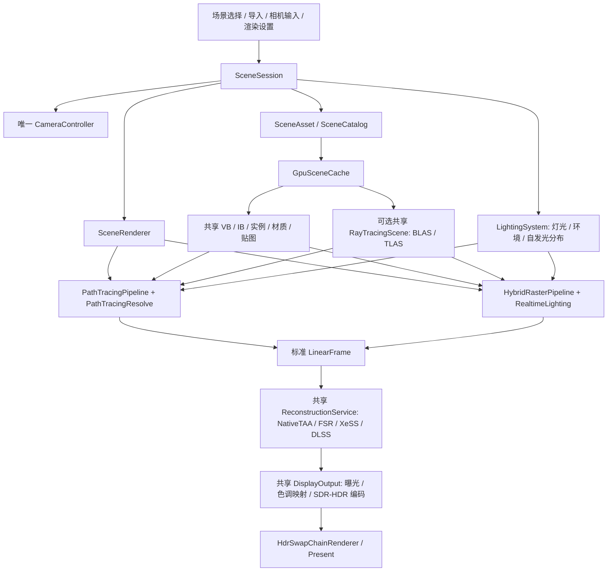
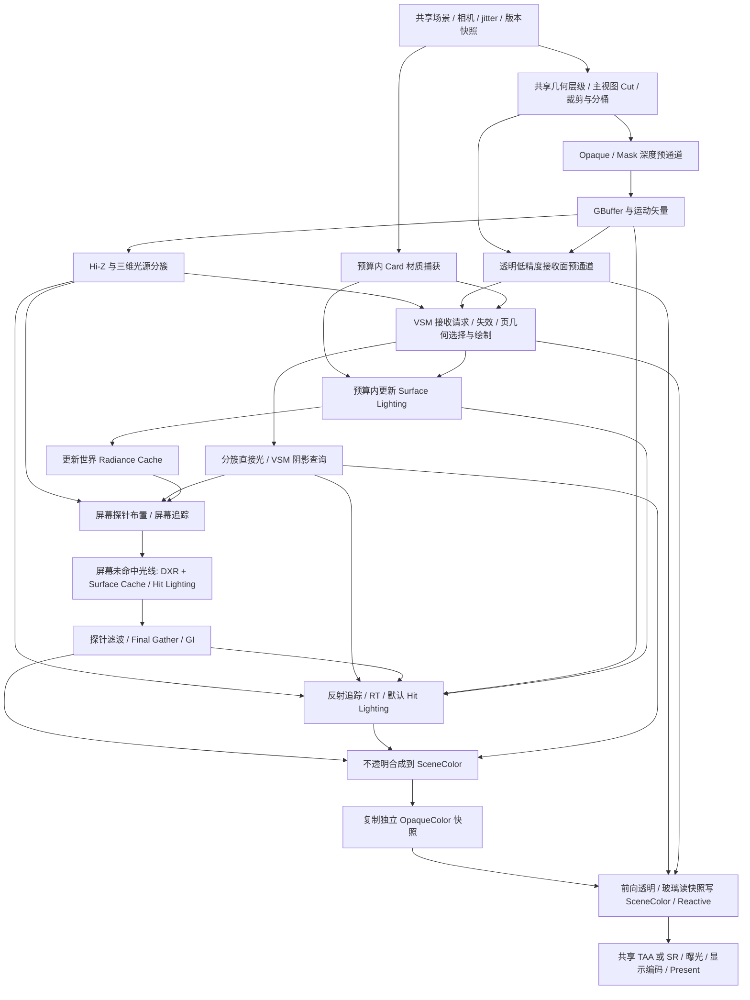

# 现代光栅化、虚拟几何与硬件光追 GI 管线设计

状态：共享场景/GPU 资源、统一帧/重建/编码与 M1 LOD0 光栅基线已落地；虚拟几何、VSM 和硬件 GI 仍为后续阶段。初稿：2026-10-26；复审及执行：2026-10-28–29。实施代码基线：`02c1fd2`。

目标是在现有路径追踪之外增加一个实时混合渲染器：主表面由光栅化确定，间接光和反射参考 UE5 Hardware Lumen 的缓存架构。场景、相机、GPU 场景资源、灯光定义、超分和显示输出抽成共享组件，两条管线只保留各自的可见性与光传输算法。

几何与直接光阴影进一步采用类似 Nanite 的动态无裂缝 LOD，以及类似 UE5 Virtual Shadow Maps 的分页阴影，详细见[虚拟几何、动态无缝 LOD 与 VSM 联合设计](VIRTUAL_GEOMETRY_SHADOWS_DESIGN.md)。该补充设计定义主视图/阴影视图共用的几何层级、VSM 缓存与平滑切换的验收边界。

## 1. 关键决策

| 项目 | 设计选择 |
| --- | --- |
| 主渲染架构 | 不透明物体采用紧凑 GBuffer + Clustered Deferred；透明和玻璃采用 Forward |
| 实时间接光 | 屏幕探针 + DXR 三角形追踪 + Surface Cache + 世界空间 Radiance Cache |
| 反射 | 屏幕追踪优先，屏幕外使用硬件光追；M4 默认 Hit Lighting，漫反射缓存只作带近似标记的回退，高粗糙度可使用探针与预过滤环境 |
| 直接光与阴影 | 分簇处理方向光、点光和聚光；目标采用 VSM clipmap/局部虚拟映射与页缓存；传统阴影作为基线与降级后端；任意屏幕外查询可用 RT 可见性 |
| 共用组件 | 一个 SceneSession、一个 CameraController、一份 GpuScene、一个 ReconstructionService、一个 DisplayOutput |
| 路径追踪 | 保留独立光传输求解器，使用同一份几何、材质、灯光与输出服务，作为参考路径 |
| 几何前提 | 静态 glTF/GLB 与实例化；派生 cluster/group 层级提供动态无裂缝 LOD，主视图、VSM 与 Card 捕获共用；不用 UE5 Nanite 代码作为依赖 |
| 能力分级 | 基础光栅需要 D3D12、SM 6.0、Resource Binding Tier 2；硬件 GI 额外需要 DXR Tier 1.0、SM 6.5 |
| 调度 | 新增通道在宿主的单个 Direct Queue 上录制，使用现有双缓冲 fence 管理生命周期 |

引入间接光缓存后，需要在光照合成前读取完整表面属性，因此这里将最初考虑的 Forward+ 调整为分簇延迟着色。Forward+ 适合基础 PBR 和透明材质；本项目现在优先考虑 GI、反射、调试视图与最终合成之间的数据流。两者的光源分簇算法仍然可以共用。

本文借鉴公开的 Lumen 原理，下面的类名、数据布局、预算和实施顺序均是本项目的设计，不能据此声称已实现 UE5 Lumen 或具有相同的性能、质量与特性。

## 2. 现有代码与需要抽取的边界

| 现有位置 | 当前职责或耦合 | 目标归属 |
| --- | --- | --- |
| [RayTracePass.cs](../DXRDemo/Shaders/RayTrace/RayTracePass.cs) | M0.1 已抽出场景目录、加载/导入、相机、灯光/曝光与 SR 设置，只保留借用入口与追踪/重建编排 | 后续将逐帧编排移至 SceneRenderer，追踪部分保留为 PathTracingPipeline |
| [MainWindow.xaml.cs](../DXRDemo/MainWindow.xaml.cs) | M0.1 的公共控制已通过 ISceneShaderPass.Session 操作共享会话，具体类型只用于路径专属参数 | 后续由管线能力描述驱动各算法专属面板 |
| [SceneAsset.cs](../DXRDemo/Scene/SceneAsset.cs) | 已有与渲染算法无关的 CPU 几何、材质、纹理、实例、灯光 | 保留为共享场景输入，不再创建第二套 RasterSceneAsset |
| [CameraController.cs](../DXRDemo/Camera/CameraController.cs) | 已有相机导航和 CameraFrame，但实例已归 SceneSession 唯一持有 | 保持共享会话所有权，切换管线保留相机姿态 |
| [DxrSceneBackend.cs](../DXRDemo/DXR/DxrSceneBackend.cs) | 已借用 GpuScene/可选 AS 租约，只保留追踪状态与私有输出描述符 | 维持共享资源与算法输出的边界 |
| [PathTracingResolve.cs](../DXRDemo/SuperResolution/PathTracingResolve.cs) | 路径降噪与玻璃 resolve 产出 LinearFrame，借用公共重建/显示服务 | NRD/OptiX/stable planes 保留专属信号，厂商 SR/RR 与显示编码只有一份实现 |
| [DxrDevice.cs](../DXRDemo/DXR/DxrDevice.cs) | 包装共享设备，允许基础光栅关闭 DXR 强制要求；仍使用同步队列 | 通用 RenderDeviceContext 独立查询能力；DXR 检查由 RayTracingScene/追踪管线执行 |
| [HdrSwapChainRenderer.cs](../DXRDemo/Hdr/HdrSwapChainRenderer.cs) | 持有呈现队列、双缓冲、宿主帧纹理与呈现 fence | 保持宿主所有权，向新管线提供借用的 RenderFrameContext |
| [ShaderCatalog.cs](../DXRDemo/Shaders/ShaderCatalog.cs)、[ShaderFactory.cs](../DXRDemo/Shaders/ShaderFactory.cs) | 现有可选渲染器入口及实例缓存 | 已注册 ray-trace / raster 两个入口，引用同一个 SceneRenderer |

场景目录只保留打包和导入的 SceneAsset，不增加第二套场景管理或历史兼容适配器；后续光栅与路径追踪都以同一 SceneAsset 为输入。

## 3. 共享组件架构



### 3.1 唯一所有者与生命周期

| 组件 | 职责 | 生命周期 |
| --- | --- | --- |
| SceneSession | 场景目录、当前文档与场景、异步加载/取消、场景提交、相机、太阳/环境/曝光设置 | 应用窗口，独立于所选管线 |
| SceneRenderer | 每帧推进一次相机、采集设置快照、选择管线、调用共享重建/输出 | 应用窗口 |
| GpuSceneCache | 上传一次公共 GPU 场景，提供 mesh offsets、bounds、稳定实例 ID、派生虚拟几何与资源租约 | 设备；场景以租约与 fence 退役 |
| VirtualGeometryRenderer | 共享几何层级遍历、误差选择、裁剪和间接绘制，按用途输出 GeometryCut | 场景派生几何版本；各用途共享数据 |
| RayTracingScene | 引用公共几何构建 BLAS/TLAS，维护材质可见性掩码 | 按需创建，按几何/实例版本更新 |
| LightingSystem | 唯一灯光/环境数据、稳定 LightId、单位与开关语义，环境预处理、自发光三角形分布 | 场景与光照版本 |
| ShadowSystem | 统一阴影查询，调度 VSM 页与预算、传统阴影降级，以及任意位置 RT fallback | 灯光投影/遮挡版本；区别于颜色/强度版本 |
| RealtimeLighting | Surface Cache、屏幕探针、世界探针与反射历史 | 混合管线使用；绑定共享场景版本 |
| ReconstructionService | 能力探测、输入尺寸、jitter、NativeTAA、厂商 SR、有效模式与失败原因 | 应用窗口；切换时重置屏幕历史 |
| DisplayOutput | 一份曝光与 SDR/HDR 编码实现，输出宿主的编码帧纹理 | 设备/输出配置 |
| RenderFrameContext | 命令列表、帧槽、上传切片、描述符切片、retirement fence | 单帧，管线借用 |

ShaderFactory 中的两个入口只负责目录身份和选择 PipelineKind。入口不各自持有 Session/相机/重建器，也不释放借用的服务。SceneRenderer 由 MainWindow 在停止渲染后统一释放一次，避免缓存入口导致重复 Dispose。

公共 GPU 顶点继续使用现有 80 字节 SceneVertex，索引保持 uint，SceneMaterial/TextureBinding 保持一个 CPU/HLSL 契约。原始几何与光追共用原始 VB/IB；自适应光栅、VSM 和 Card 捕获引用同一源顶点，增加派生层级索引与 metadata。首期不在每次选择 LOD 时重建 BLAS。缓冲状态允许各自所需的只读用途，纹理读取明确声明 Pixel/NonPixelShaderResource，不能沿用当前只有 NonPixelShaderResource 的假设。

虚拟几何的统一选择单位是逻辑网格和逻辑几何实例，不是 glTF primitive 拆分后的渲染实例。共享 SceneAsset 需补充稳定 `LogicalMeshId`、`GeometryInstanceId` 和 primitive material ranges，使同一逻辑节点的多材质 primitive 能参与同一 DAG Cut；原始 RT BLAS/TLAS 保持现有身份映射。缺少这些身份的旧资产只能按单 primitive 保守回退，不得按名称或相同变换启发式合并。

BLAS/TLAS 也共用，但它们是 GpuScene 的可选扩展。不能为了纯光栅启动而提前构建。当前静态场景只在几何/实例变化时构建，不照搬动态引擎逐帧重建 TLAS 的成本。不同光线用途使用统一定义的实例掩码，已有玻璃阴影掩码迁移时保留其语义。

### 3.2 场景事务与线程规则

1. 后台解析 glTF、解码纹理并形成候选 SceneDocument，带加载请求序号和取消令牌。
2. 渲染线程准备候选 GpuScene；可选 RT 管线还需准备对应 RayTracingScene。上传资源存活到提交 fence 完成。
3. CPU 场景、GPU 租约和默认相机一起提交为新的 SceneSnapshot。失败、取消或旧请求晚到均保留原场景。
4. 同一个 SceneAsset 切换管线时复用公共资源；如果首次启用硬件 GI，需要补建加速结构，不能重新导入或重新上传全部贴图。管线激活也是事务，所需资源准备成功后才切换，有错误则保留原有效管线并报告原因。
5. UI 线程只发布命令/设置。创建 PSO、提交 GPU 工作、切换有效管线和释放 GPU 资源都在渲染线程执行。

### 3.3 标准帧输出

管线交给公共后处理的是 `LinearFrame`，不是 PbrSignals，也不是已做 PQ/sRGB 编码的图像：

| 字段 | 统一语义 |
| --- | --- |
| Color | 当前输入分辨率的线性 Rec.709 HDR，未做显示曝光，FP16 RGBA |
| Depth | 统一的有限远平面反向 Z，near=1、far/sky=0；同时携带 near/far/FOV 与有效表面标记 |
| Motion | 当前 → 前一帧，单位为输入像素，排除 jitter，纹理 Y 向下，RG16_FLOAT |
| NormalRoughness | 世界空间着色法线与 perceptual roughness；按后处理需要提供 |
| Reactive | 透明、折射和无法可靠重投影区域的响应遮罩 |
| Camera / Jitter | 当前与上一帧无抖动矩阵、当前 jitter 的输入像素偏移，以及渲染帧序号 |
| Revisions | Scene、Geometry、Material、Lighting、CameraCut、Pipeline、Output 的版本；几何表示切换另有局部 mask，阴影投影另有 ProjectionEpoch |
| ResolvePolicy | 原生输出是否需要 TAA、是否为路径参考累计、是否允许厂商重建 |

常规 PathTracingPipeline 经路径专属降噪、stable planes 与玻璃 resolve 后转换到该契约；HybridRasterPipeline 经 GI/反射重建和透明合成后输出同一契约。NRD 与 OptiX 的输入保留为专属信号，不强行让光栅伪造这些信号。

DLSS Ray Reconstruction 依赖路径信号，作为共享 ReconstructionService 的可选扩展端点；启用时 PathTracingPipeline 提供未降噪的原始 radiance 与额外 guides，旁路 NRD/OptiX/自定义时间预滤波，由 RR 负责重建。混合管线首期只使用 DLSS SR，既不伪造 RR 输入，也不创建第二份 DLSS 运行时封装。

### 3.4 UI 与设置只保留一套

场景、导入、相机、太阳、环境、曝光、HDR、SR 模式和比例都控制共享对象。路径专属保留 SPP、反弹次数、NRD/OptiX；混合专属提供 LOD 屏幕误差、VSM 页/软阴影预算、GI 预算、反射质量和缓存调试视图。

持久化保留稳定 `ShaderId`，新增各管线专属设置区。已有公共字段迁移一次，不复制出 RasterCamera、RasterSceneIndex 或 RasterRenderScale。使用 `RequestedMode` / `EffectiveMode` 区分用户选择与当前能力：例如已选 DLSSD 时切到光栅，实际使用可用的 DLSS SR，否则 NativeTAA；切回路径追踪可恢复原请求。界面报告有效模式和原因。

切换不改变当前模型、相机姿态和灯光设置；只重置有关的屏幕历史。非活动管线的持久资源允许缓存，受显存预算控制，不能由 ShaderFactory 无限保留两套全部中间纹理。

## 4. Hardware Lumen 借鉴范围

Epic 的公开说明将屏幕追踪、Surface Cache 与硬件三角形追踪组合起来；Surface Cache 以 Cards 保存表面信息并分帧更新光照。公开的 Final Gather 介绍进一步使用屏幕辐射缓存和世界空间辐射缓存复用稀疏光线。[Lumen 技术细节](https://dev.epicgames.com/documentation/en-us/unreal-engine/lumen-technical-details-in-unreal-engine)、[Epic 技术文章](https://www.unrealengine.com/tech-blog/unreal-engine-5-goes-all-in-on-dynamic-global-illumination-with-lumen?lang=en-US)

对应到本项目，明确采用以下分工：

| 层级 | 回答的问题 | 本项目表示 |
| --- | --- | --- |
| 几何可见性 | 光线击中了哪里？ | 当前帧深度/Hi-Z，失败后查询共享 BLAS/TLAS |
| 表面缓存 | 命中表面是什么材质，向外发出多少漫反射光？ | Cards 参数化、材质 atlas、漫反射辐射亮度 atlas |
| 屏幕探针 | 当前可见表面从哪些方向收到光？ | 低分辨率、几何自适应的方向辐射探针 |
| 世界辐射缓存 | 屏幕外/远处方向的光如何稳定复用？ | 相机附近的稀疏多级空间探针，保存方向光照与可见性信息 |
| 反射 | 当前观察方向看见什么？ | 屏幕追踪、RT、默认 Hit Lighting 及受限的漫反射缓存回退 |

Surface Cache 存在物体表面，Radiance Cache 存在空间中；不能把二者合并成一张无几何约束的“GI 贴图”。硬件光追只是求交方式，也不能替代这两类缓存。

Lumen 的默认缓存着色和高质量 Hit Lighting 是质量/成本选择；后者需要在命中点计算材质并发射阴影光线，成本更高。[Epic 硬件光追说明](https://dev.epicgames.com/documentation/en-us/unreal-engine/hardware-ray-tracing-in-unreal-engine)

本项目首先围绕 Kitchen、Bistro、Rainy Corner 的静态三角形场景实现这条架构，并将虚拟几何 LOD 与 VSM 纳入目标。软件距离场 Lumen、World Partition、体积 GI 和复杂动画暂不纳入。基础光栅可使用环境照明降级模式；该模式明确显示 GI 不可用，不宣称具有 Lumen 的屏幕外间接光。

## 5. 混合管线逐帧流程



图中的依赖在首期按单队列顺序录制。漫反射 GI 的屏幕追踪读取独立的 ScreenDiffuseRadiance：当前 emission + 漫反射直接光 + 上一帧经验证的漫反射间接光，不混入视角相关镜面项。反射屏幕追踪读取当前帧的逻辑 `OpaqueBase = Emissive + AnalyticDirectLighting + DiffuseBRDF × GatheredIndirectIrradiance`，由 DIRECT、GATHER 和 GBuffer 在采样时组合，不含正在计算的间接镜面，也不依赖上一帧最终颜色；图中的三条输入边不要求再物化一张全分辨率 OpaqueBase。两者均禁止采样尚未生成的当前最终合成图形成反馈环。

透明低精度接收面预通道只生成位置/深度和阴影请求所需语义，不提前执行正式透明光照合成；正式透明阶段复用其结果。COMPOSE 先写入 SceneColor，随后复制独立 OpaqueColor 快照；玻璃折射只读快照，透明混合继续写 SceneColor，禁止把同一纹理同时作为折射 SRV 和透明 RTV/UAV。

### 5.1 光栅主表面与直接光

- 基线先按实例 bounds 做视锥裁剪，随后由共享虚拟几何层级按屏幕误差生成合法 Cut；按 OPAQUE、MASK、BLEND、Transmission、双面与镜像变换分桶，复用源顶点、派生索引并使用间接绘制。
- 深度采用 D32_FLOAT、clear=0、GREATER_EQUAL。不透明 GBuffer 使用只读深度和相同投影，避免深度与材质采样位置不一致。
- Hi-Z 根据用途保留明确的归约语义；反向 Z 用于保守遮挡时采用区域最远遮挡深度的 min 归约。含天空/空洞的区域不能当作完整遮挡，屏幕光线追踪按同一深度约定比较和验证厚度。
- MASK 的 alpha cutoff、UV 变换和采样语义在深度、GBuffer、阴影与 RT any-hit 中一致；BLEND/玻璃不写入不透明深度。
- Normal 使用逆转置；tangent handedness 计入负缩放。统一 row-vector CPU/HLSL 约定，HLSL 矩阵显式声明 row_major；DXR 的 3×4 实例描述另做显式布局转换。
- 分簇起点为 16×16 输入像素、24 个对数 Z 切片，按实际 near/far 建立体积。使用全视锥分簇，使透明物体也能查询；首期不按不透明 tile 深度排除透明层需要的灯光。
- 光源列表使用 count → prefix sum → fill；超过索引预算的 cluster 标记 overflow，并回退遍历局部光源保证正确性，同时报告统计，不能静默丢灯。
- 直接光共用 glTF 物理单位与 GGX/Smith/Fresnel 材质函数。目标阴影后端采用方向光 VSM clipmap、点光六面/聚光单映射的虚拟 mip 与页缓存；预算不足时优先降低精度并保留粗覆盖，报告有效后端和 fallback。

M1 基线用稳定 CSM 和传统局部阴影验证直接光；作为同一个 ShadowSystem 的对照/降级后端，不另建一套 UI 或灯光数据。VSM 的分页、clipmap、几何联动、PCF/SMRT 与失效规则见[联合设计第 5 节](VIRTUAL_GEOMETRY_SHADOWS_DESIGN.md#5-vsm直接光阴影的目标实现)。光栅阴影与 RT 可见性共用遮挡材质语义，首期不包含彩色玻璃焦散阴影。

### 5.2 Surface Cache：先解决覆盖，再解决更新

**表示与构建。** 每个 mesh 在局部空间生成 Card 描述，在后台预处理；实例共用 Card 布局，但光照 atlas 分配按实例区分。初始方向可取局部 ±X/±Y/±Z，复杂凹面需要按连通分量/法线簇增加捕获区域。不能认为六个包围盒方向天然覆盖厨房内部。

每张 Card 用正交光栅捕获 base color、漫反射反照率、几何/着色法线、深度、emission 和材质标记。重叠层无法被单次捕获表示时增加 Card 或划分捕获区域；不修改原场景的可见几何。版本缓存键包含 mesh 数据、材质和 Card 构建算法版本；首次导入可后台生成，打包场景可离线预生成。

**命中查询。** 由 RT 命中的 InstanceId、PrimitiveId、barycentric 找到局部点与法线，选择投影方向相容的 Card，再做捕获深度和表面法线匹配。atlas 需要 tile padding、边缘扩展和受控 mip，不能直接在不同 Card 之间双线性混合。没有有效覆盖时回退到有预算的 Hit Lighting；预算耗尽时返回低置信度的世界探针估计并标记调试，不能把洞解释成无遮挡天空。

**缓存内容。** 材质数据与光照数据分开，光照只缓存近似视角无关的漫反射出射辐射亮度：

```text
L_surface = L_emissive + diffuseReflectance / pi * (E_direct + E_indirect)
```

镜面项不写进这张漫反射辐射缓存。金属的 diffuseReflectance 趋近零，不能错误地把金属 base color 当作漫反射；unlit 采用自身颜色的明确出射语义。

**直接光更新。** 按 Card/page 分配重要光源，并通过 ShadowSystem 为捕获表面请求低频 VSM 覆盖或使用 HWRT 阴影查询；不能假定主视图深度已请求屏幕外所需的页。太阳、punctual 参数与主表面使用同一 LightingSystem。小而亮的自发光面通过共享 emitter 分布增加重要性采样，采样 PDF 与命中发光表面的估计保持一致。

**多次反弹。** 第一版先验证一跳间接光；之后让 page 的间接辐照度从上一版本的 Surface Lighting/世界缓存估计，采用双版本读写与分帧迭代。不能在同一轮读写同一张 radiance atlas，也不能把“跨帧迭代”当作已经证明无限反弹收敛。需要能量、稳定性与亮度收敛的实测。

**调度。** 用可见性反馈、屏幕外光线命中次数、page age 和版本变更决定优先级。新可见页、光照改变区域优先，其余按预算轮转；材料捕获与光照更新分别计时。atlas 设定容量与 LRU；新分配/复用的 tile 先清空 validity，避免读取另一物体的旧光照。

### 5.3 Screen Probe Gather 与世界 Radiance Cache

屏幕探针先按 16×16 像素网格布置，在深度/法线断层追加探针。一个格子不能只有一个跨越前景与背景的探针；样本保存接收表面、法线、正 view depth、材质与历史置信度。

每个探针用八面体方向图保存入射 radiance 和命中距离，首个验证配置为 8×8 个方向。方向采样可由历史能量引导，但保留覆盖整个有效域的采样概率和正确 PDF。屏幕追踪经 Hi-Z 验证厚度与方向；屏幕外、遮挡不确定或历史失效时进入 HWRT，不返回零来冒充有效估计。

HWRT 路径为“求交 → 读取 Surface Lighting，缺失时 Hit Lighting → miss 时采样环境”。首期复用现有 DXR 1.0 / lib_6_5 的 DispatchRays；RayQuery 作为 DXR 1.1 / SM 6.5+ 的后续优化，按设备查询和测量决定，不强制 SM 6.9 或 SER。

**几何表示门槛。** M1.5 和 M4 的正确性基线使用主视图 LOD0；M2 仍可独立验收光栅/VSM 的动态 LOD，但硬件 GI 启用时不得自动继承该实验表示。自适应主表面与 LOD0 BLAS 不共面，光线起点偏移不能普遍区分错误自遮挡、真实遮挡和薄墙漏光。混合表示必须作为独立质量档，明确起点重定位、命中拒绝或匹配 RT proxy 中的一种可验证方案，并通过薄墙、近接触、掠射和 LOD 往返切换测试后才允许默认开启；不能无限增大 bias 掩盖差异。

世界缓存采用围绕相机的稀疏多级探针网格；空间探针保存方向 radiance、距离/可见性统计、年龄、场景与光照版本。移动相机时以整格滚动，失效进入的新区域，不整体重置。插值同时考虑可见性、接收点与法线关系，拒绝跨墙混合，并提供 probe relocation/invalid 标记，避免室内漏光。

世界缓存更新只能读取已完成的上一版本 Surface Lighting/世界缓存，再发布当前版本；Surface 间接光更新可消费已完成的世界缓存版本。缓存缺失回退也只读已完成且有效的版本，禁止 Surface → World → Surface 在同一轮递归读写。冷启动没有有效结果时标记低置信度，优先安排实际追踪；不能用未初始化历史补齐。

近处命中优先走几何/Surface Cache；远处方向可以使用世界缓存，按距离和置信度切换。屏幕缓存与世界缓存都保存入射光，Final Gather 才与全分辨率表面 BRDF 结合，避免把不同颜色物体之间的 irradiance 与已乘反照率颜色混用。

硬件 GI 打开时，环境光由 miss/探针承担遮挡后的贡献，不再额外叠加一份全屏 IBL 漫反射。GTAO 只可作为有限范围的接触细节修正，默认不再全量乘一次 AO，防止重复遮蔽。

### 5.4 反射与透明

反射按 roughness 分配采样预算：低粗糙度需要方向准确的 RT 反射，中等粗糙度重投影/空间重建，高粗糙度可使用探针与预过滤环境的近似。屏幕追踪先找可验证命中，读取上述不含间接镜面的当前帧 OpaqueBase；失败后追踪共享三角形场景，屏幕外物体必须可见于反射。该屏幕颜色只表示有限次数的出射光近似，不形成递归镜面反馈。

M4 的 RT 命中默认使用 Hit Lighting：在命中点重新求材质、直接光及其可见性，并补充有效的缓存间接光。漫反射 Surface Cache 不含命中表面的直接镜面出射项，金属的漫反射又趋近零，因此不能把“低粗糙度 RT + 默认读取漫反射缓存”当作完整反射路径。后续只有高粗糙度、漫反射占主导的命中才允许使用带置信度和调试标记的缓存近似；镜中金属与光滑介质必须走 Hit Lighting 或明确报告降级。Hit Lighting 保留预算和最大深度，第一版不尝试镜面中的递归镜面；缓存近似与 Hit Lighting 各有调试对照。

BLEND 首期按实例/primitive 后到前排序，使用预乘 alpha、只读不透明深度；相交透明几何的排序误差记录为限制。Transmission 与 alpha blend 是独立语义：玻璃首期采用 Fresnel、IOR、厚度吸收和屏幕背景折射，屏幕外反射可使用 RT。不透明合成完成后复制 `OpaqueColor` 快照，折射只读该快照，透明混合写入原 SceneColor；快照复制和状态转换计入 Transparent/Output 的时间与显存预算，后续只有在测量证明有价值时才改为其他透明积累结构。玻璃的最近有效表面提供运动/响应信息，不覆盖用于 SR 的不透明背景深度约定。

透明物体的低频间接光来自世界探针。多层实体折射、嵌套介质与焦散仍由现有路径追踪提供；不把这部分误列为首期混合光栅已具备的能力。glTF 的 alpha 与 transmission 语义依据 [glTF 2.0](https://registry.khronos.org/glTF/specs/2.0/glTF-2.0.html) 和 [KHR_materials_transmission](https://github.com/KhronosGroup/glTF/tree/main/extensions/2.0/Khronos/KHR_materials_transmission)。

### 5.5 合成的能量边界

```text
Color = Emission
      + AnalyticDirectLighting
      + DiffuseBRDF × GatheredIndirectIrradiance
      + IndirectSpecularReflection
```

直接光是太阳和 punctual 的直接贡献，GI 是间接入射光；缓存的 L_surface 供二次命中读取，不能直接当作当前像素的额外一层光。小发光面在探针中的 NEE 与方向采样命中需要匹配权重，避免计算两次。关闭“外加光照”时同时关闭外加太阳与环境的所有缓存贡献，保留模型灯光与自发光。

## 6. 公共重建、时间历史与输出

ReconstructionService 只接收标准 LinearFrame，在一次调用中选择 NativeTAA、厂商 SR 或 passthrough。NativeTAA 用于需要抗锯齿的原生光栅输出；厂商 SR 自带时间重建，不预先叠加一次 NativeTAA。路径降噪、GI 探针滤波属于信号重建，可以先于 SR，但不是第二套全屏 TAA。路径参考累计模式保持其原有累计语义。

有限反向 Z 的约定为正 view depth `z`、近远平面 `n/f`：

```text
d_reverse = (n * f / z - n) / (f - n)
motion = previousUnjitteredPixel - currentUnjitteredPixel
```

浮点反向 Z 的精度动机见 [NVIDIA 深度精度说明](https://developer.nvidia.com/blog/visualizing-depth-precision/)。

现有 [NativeReconstruction.cs](../DXRDemo/SuperResolution/NativeReconstruction.cs) 的 Frame 没有深度约定字段，原生桥接创建 FSR/DLSS 时也没有启用反向深度标志。第一步在共享适配层转成 SDK 当前使用的常规 R32_FLOAT 深度，携带真实 near/far/FOV，尽量保持现有 ABI；后续若原生支持反向 Z，使用显式 DepthConvention 和上下文配置版本，不能只替换纹理。

jitter 由共享服务产生，调用方使用明确的像素偏移与投影变换；光栅和 ray-primary 使用各自的投影/逆投影，不能直接复制现有 `JitterX = -jitter.X`。每个厂商适配器按 SDK 约定转换。必须验证“相机静止但 jitter 变化时，motion≈0”，以及 Y 翻转和 50% 比例下的像素单位。[FSR 的深度与运动输入契约](https://gpuopen.com/manuals/fidelityfx_sdk/techniques/super-resolution-upscaler/)

| 变化 | 屏幕 TAA/SR/GI/反射历史 | Surface 材质缓存 | Surface/世界光照缓存 |
| --- | --- | --- | --- |
| 正常相机移动 | 重投影与局部拒绝 | 保留 | 保留，更新可见反馈/滚动新区域 |
| 相机 cut / 切换管线 | 重置 | 保留 | 版本相同可保留，提高过期页刷新优先级 |
| 太阳/环境/灯光改变 | 失效有关光照历史 | 保留 | 按 LightingRevision 失效或降置信度，并提高更新预算 |
| 材质/几何改变 | 失效受影响区域 | 重新捕获有关页 | 失效有关页/探针；几何变化还更新 AS |
| 主视图几何 LOD 切换 | 局部 representation-change mask 拒绝有关历史 | 使用独立捕获 Cut 时保留 | 只拒绝不匹配表面，不整体清空；VSM 按自身几何依赖决定是否重绘 |
| 导入新场景 | 全部重置 | 换 SceneEpoch | 换 SceneEpoch |
| 分辨率/SR 算法改变 | 重建有关屏幕资源 | 保留 | 保留 |
| 显示曝光/HDR 改变 | 场景线性历史保留 | 保留 | 保留；只重配显示输出 |

生成并提交 GPU 的帧序号推进 jitter 和历史；DXGI 因忙碌未呈现不等于 GPU 帧未执行，不能按成功 Present 次数回滚时间状态。

DisplayOutput 共用现有项目的色调映射与编码行为，避免接入时顺带改变参考图：在线性光照/重建之后统一应用曝光，随后 SDR 映射/编码，或亮度映射、Rec.709 → Rec.2020、PQ。HDR 宿主只复制已编码帧，不再次施加传递函数。

## 7. GPU 资源、队列与性能预算

### 7.1 基础输入资源

| 资源 | 格式/用途 |
| --- | --- |
| Depth | R32_TYPELESS 资源，D32_FLOAT DSV、R32_FLOAT SRV |
| BaseColorAO | R8G8B8A8_UNORM_SRGB 视图；RGB 为线性颜色经硬件编码存储，A 为材质 AO |
| ShadingNormalRoughnessMetallic | RGBA16_FLOAT；八面体法线 XY、roughness、metallic |
| GeometricNormal | RG16_SNORM；几何法线，用于探针起点偏移与几何拒绝 |
| EmissiveFlags | RGBA16_FLOAT；RGB HDR 自发光，A 为少量材质/有效表面标记 |
| Velocity | RG16_FLOAT，输入像素单位 |
| SceneColor | RGBA16_FLOAT，不透明合成及透明混合后的线性 HDR |
| OpaqueColor | RGBA16_FLOAT，透明前的独立不透明快照，仅供屏幕折射等只读采样 |
| Reactive | R8_UNORM |
| TransparentReceivers | 低分辨率透明接收位置/深度与请求语义；分辨率、层数和格式另计 |
| VSM | 常规 light-space Z 的物理深度页池，虚拟页表与几何依赖另计 |
| Surface Cache | page 化材质 atlas + 双版本光照 atlas，容量可配置 |
| Probe 数据 | 方向 radiance、距离、置信度/年龄，独立于最终图像的时间历史 |

不存全分辨率世界坐标，使用深度和逆抖动矩阵重建。计入新增的 OpaqueColor 快照后，基础资源格式累计约 49 bytes/输入像素；这不含 Direct/Gather 等光照中间结果、TransparentReceivers、Hi-Z、探针、缓存、SR SDK 和模型。反射的 OpaqueBase 默认按需组合 DIRECT、GATHER 与 GBuffer，不再额外物化一张全分辨率纹理。

作为显存规划示例，当前基础输入在 1080p 约 97 MiB，在 4K 约 388 MiB；两份 HDR+深度时间历史分别约 47/190 MiB；现有两张 4K RGBA16 编码输出约 127 MiB。VSM 的起始物理池按 2048 个带 guard 的 128² 页估计约 136 MiB，详见联合设计；M1 的 4×2048² D32 CSM 基线约 64 MiB，两种后端按选择计费。几何派生数据、缓存和 SDK 还有独立预算，4K 原生不能沿用 1080p 的显存假设。

Surface atlas 建议从总计 256 MiB 的材质/双版本光照预算开始，世界缓存从 64 MiB 开始做压力验证。这些是设计起点，尚无设备测量。预算不足优先降低 page 分辨率、探针更新数量或输入比例，并报告降级；不能只降低 ray count 而让 atlas 无限增长。

### 7.2 单队列与宿主衔接

当前多个 DXR/重建后端各自 `SignalAndWait()`。新增管线改为借用宿主 Direct Queue 的 RenderFrameContext，将光栅、GI dispatch、SR、编码和全屏输出按顺序录制，不每个 pass 提交并等待。

IShaderPass/IHdrShaderRunner 保留兼容入口；新增原生命令录制接口供 SceneRenderPass 使用。HdrSwapChainRenderer 在渲染线程识别并调用该接口，统一提交与 signal。迁移中的旧追踪后端可暂时保留原同步提交，作为适配器接入标准帧；之后逐步把 Trace/Resolve 改为录制接口。

`GpuDiagnostics.Draw()` 与加载画面已迁移到原生 `GpuFrameEffects` compute pass。新管线把命令录制到宿主列表时，应复用同一 HLSL 与原生绑定并改为同队列录制，不能在尚未提交的宿主命令列表之间插入另一次同步提交；现有 GPU HUD 行为保持不变。

当前原生 Temporal 仍与 Prepare、历史及编码编排耦合，独立 NativeTAA 是 M0/M1 的实际交付，不是把现有路径累计直接改名。OptiX/CUDA 与玻璃合成继续依赖明确的跨队列完成点；M0 只保留这些仍被现行算法需要的同步交接，不增加旧框架兼容层或 encoded-only 适配路径。

每帧槽独占 CPU 写入的常量切片、动态描述符、查询/readback 区。只在槽 fence 完成后重用。GPU 顺序访问的临时图像可在同队列上复用，历史显式 ping-pong；场景/尺寸资源退役等待最后引用它们的 fence。SDK 调用后重新绑定所需 root signature、PSO 和 descriptor heaps，不假设外部代码保留绑定。

资源状态与 UAV 顺序由轻量 PassScheduler 根据每个 pass 的输入/输出声明处理：深度写入/只读、RTV→SRV、UAV 生产→消费、间接参数→INDIRECT_ARGUMENT 均显式表达。开始采用现有 resource barrier API；首期只做状态/依赖与生命周期追踪，不引入复杂内存 alias 或多队列调度。[D3D12 队列同步说明](https://learn.microsoft.com/en-us/windows/win32/direct3d12/user-mode-heap-synchronization)

### 7.3 测量方式

各自记录 GeometrySelect、Raster/GBuffer、VsmPageRequest/Depth/Projection、Direct、CardCapture、SurfaceLighting、WorldCache、ProbeTrace/Gather、Reflections、TransparentReceiver/Transparency、OpaqueSnapshot、SR/Output 的 GPU 时间；记录所选几何量、CPU 提交、几何/VSM overflow、缓存命中率、无覆盖比例、page age、光线数、AS 构建次数、显存和实际呈现帧率。

建议先以 1080p 输入 → 4K 输出建立 60 Hz/16.67 ms 的整帧优化目标；这是目标，不是承诺。首轮拆分预算可用：主表面+直接光 4 ms，GI+反射 6 ms，透明+SR+输出 3 ms，余量约 3.7 ms。缓存捕获和 AS 更新也计入总帧，单帧超预算必须可见。测试同时覆盖静止、持续移动、突然转身、光照改变和首次导入。

8×8 方向、16×16 探针网格在 1080p 已约有 52 万条方向样本，仍不含自适应探针与反射。必须允许时间分摊、历史引导与独立 ray budget，不能把低分辨率探针误认为几乎无成本。

## 8. 模块与文件组织建议

```text
DXRDemo/
  Rendering/
    SceneRenderer.cs              # 唯一逐帧编排器
    SceneRenderPass.cs            # catalog 的轻量兼容入口
    RenderDeviceContext.cs        # 通用设备能力与借用的宿主设备
    RenderFrameContext.cs         # 命令录制、帧槽、上传与描述符
    GpuSceneCache.cs               # 一份公共 GPU 场景
    RayTracingScene.cs            # 两种硬件光追用途共用的 BLAS/TLAS
    LinearFrame.cs                # 公共后处理输入
    PassScheduler.cs              # pass 依赖、状态与退役
    Pipelines/
      PathTracingPipeline.cs      # 现有追踪算法的适配与迁移
      PathTracingResolve.cs       # NRD/OptiX/stable planes/实体玻璃
      HybridRasterPipeline.cs
  Scene/
    SceneSession.cs               # 从 RayTracePass 抽出
    SceneCatalog.cs               # 打包与导入的 SceneAsset 场景目录
    SceneAsset.cs                 # 继续共用
  Geometry/
    VirtualGeometryAsset.cs       # cluster/group DAG 派生数据
    VirtualGeometryRenderer.cs    # 各用途共用的层级选择与裁剪
  Lighting/
    LightingSystem.cs             # 公共灯光、天空、发光分布
    ClusteredLightGrid.cs
    Shadows/                      # ShadowSystem、VSM 页缓存与页绘制
    RealtimeLighting.cs
    SurfaceCache.cs
    CardBuilder.cs
    ScreenProbeGather.cs
    WorldRadianceCache.cs
    HybridReflections.cs
  SuperResolution/
    ReconstructionService.cs      # 共享 TAA/SR/RR 能力端点
    NativeReconstruction.cs       # 保留并复用唯一厂商 ABI
  Hdr/
    DisplayOutput.cs              # 从现有 Reconstruction 编码中抽出
    HdrSwapChainRenderer.cs       # 继续持有呈现队列/交换链
  Shaders/
    Shared/                       # 场景 ABI、UV/材质、BRDF、环境、编码
    Geometry/                     # 层级选择、裁剪、间接绘制
    Shadows/                      # VSM 请求、页绘制、投影与 SMRT
    Raster/                       # 深度、GBuffer、直接光、透明
    Lighting/                     # cache capture/update、probe、GI、反射
    DXR/                          # 路径传输、RTXPT 采样与专属重建
```

共享 HLSL 抽取材质语义和 BRDF 求值，不把 ray-cone LOD 或像素导数藏在同一个采样假设里：光栅/捕获使用梯度或显式 LOD 适配，光追使用 ray cone。RTXPT 的路径状态、MIS、BSDF 采样和介质栈继续归路径传输。共享材质提取必须先用现有探针验证，避免重构同时悄悄改变画质。

主工程当前只复制 `Shaders/DXR/**`；新增目录需更新资源复制规则。IntegrationProbe 使用显式 Compile Include，新增 Rendering/Lighting/Shared Shader 文件也必须接入，不能假定主工程可编译就代表离屏验证入口可用。

## 9. 分阶段实施与验收

| 阶段 | 交付内容 | 验收重点 |
| --- | --- | --- |
| M0：共享层抽取 | SceneSession/目录/相机控制；共享灯光、GpuScene/AS 租约；稳定 LogicalMeshId/GeometryInstanceId；重建与输出拆分；路径追踪适配新接口，保留现行 OptiX/CUDA 同步交接 | 现有场景、玻璃、太阳、NRD、OptiX、SR、累计探针回归；UI 不再依赖 RayTracePass 承担公共控制；同场景资源不重复上传；原生 GpuTexture、GPU HUD 与必要跨队列交接不因单队列迁移失效 |
| M1：完整光栅基线 | GBuffer、分簇直接光、传统阴影基线、环境降级照明、透明、独立 OpaqueColor 折射快照、统一 motion/depth、公共 TAA/SR/HDR | glTF 材质、负缩放、MASK、双面、切换/导入/尺寸和 HDR；折射不存在同纹理读写；无 DXR 的可用设备可启动基础光栅；此阶段不宣称完成硬件 GI |
| M1.5：混合 GI 垂直切片 | 固定主视图 LOD0 与 CSM；最小屏幕/HWRT 一跳 GI；RT Hit Lighting 反射；共享 LinearFrame 与 SR；不引入 Surface/World Cache | 先排除动态 LOD/VSM 变量，验证共享 GpuScene/AS、单队列契约和实际 ray/shading；镜中金属、屏幕外反射、薄墙/接触/掠射与 GI 能量对照通过后再扩大范围 |
| M2：动态无裂缝 LOD | 后台 cluster/group 层级构建、逻辑实例身份、误差与边界校验、CPU 参考 Cut、GPU 遍历/裁剪与 ExecuteIndirect，先全量驻留 | 跨材质替换组在同一 GeometryInstanceId 下原子选择；合法 Cut 覆盖、边界无裂缝、近裁剪/镜像/非均匀缩放、预算 overflow；量化前后均验收；测量切换平稳性 |
| M3：VSM | 方向光 clipmap、局部光 mip/六面页表、物理页池、几何页分桶、缓存失效、粗覆盖/fallback，再加入 SMRT | 页边界/clipmap/cube face、平移吸附后的页复用、屏幕外 caster、当前帧透明接收面预通道/Card 请求、太阳转向与几何移除；深度页/投影分别计时 |
| M4：完整硬件 GI 验证路径 | 屏幕探针、HWRT 一跳 GI、屏幕外反射、默认 Hit Lighting；复用现有发光面采样分布；混合几何表示作为独立质量档 | 先在 LOD0 基线验证 Kitchen 自发光邻面照明、关闭屏幕追踪后的 GI 和屏幕外反射；混合表示通过薄墙、近接触、掠射与 LOD 往返测试后才默认开启；测量实际 ray/shading 成本 |
| M5：Lumen 式缓存架构 | Cards/覆盖诊断、Surface Lighting、世界缓存、多次反弹迭代、反馈与更新预算；受限的漫反射缓存反射回退 | 缓存命中率/覆盖/age 可观测；薄墙漏光、灯光响应、转身、新场景与 atlas 淘汰正确；镜中金属/光滑介质仍由 Hit Lighting 保持正确；与路径参考对照质量及整帧时间 |
| M6：连续过渡与规模扩展 | Geomorph 映射/连续过渡独立验收；几何 streaming、驻留预算与 Mesh Shader 按需求分项推进；按测量优化 RayQuery | Geomorph 的边界/运动矢量/拓扑替换验证通过才宣称严格连续；streaming 缺页保留完整粗 Cut；与固定驻留路径对照性能 |

M1.5 是刻意提前的风险隔离切片，避免在完成虚拟几何和 VSM 后才暴露共享帧契约或混合光传输问题。M4 的 Hit Lighting 是 M5 的缓存缺失回退和默认反射命中路径。M2 的虚拟几何先解决无裂缝与动态选择，M3 提供目标直接光阴影，M5 满足 Hardware Lumen 式光照目标；严格连续过渡作为 M6 的独立交付。间接绘制采用 PSO/材质桶，GPU 生成绘制参数并由 ExecuteIndirect 消费，避免假设一条命令能切换任意 PSO。[D3D12 间接绘制说明](https://learn.microsoft.com/en-us/windows/win32/direct3d12/indirect-drawing)

重点验收场景与度量：

1. **共享与回归**：相同 SceneAsset/相机在两条管线间反复切换，导入不重跑、公共 GPU 资源不翻倍；取消/失败仍显示旧场景，镜头不跳变；跨材质逻辑实例身份稳定，原生 GpuTexture/GPU HUD 与 OptiX 同步交接继续通过现行探针。
2. **GI 正确性**：用封闭房间、彩色墙、窗口、单个发光面生成可复现样例；遮挡天空后室内变暗，出现颜色反弹，小灯不因转出屏幕失去照明。关闭 Screen Traces 单独验证缓存/RT 路径，并先固定 LOD0 排除表示差异。
3. **混合几何表示**：LOD0 基线与自适应主表面分别测试薄墙、近接触、掠射和 LOD 往返切换，分别统计错误自遮挡与漏光；不能只检查光栅无裂缝，也不能通过无限增大 ray bias 让测试变绿。
4. **缓存与反射**：记录无覆盖像素与 fallback 比例；相机转身、atlas eviction、灯光开关后无旧物体残影；设定最大未更新时间并测量响应。镜中金属、光滑介质和屏幕外物体与 Hit Lighting/路径参考对照，漫反射缓存回退必须显示近似或降级状态。
5. **帧图与透明**：反射屏幕输入不包含当前帧间接镜面，不使用未初始化的上一帧颜色；透明接收面预通道先于 VSM 请求；OpaqueColor 快照与 SceneColor 是不同资源，折射采样期间不存在同纹理 SRV/RTV/UAV 读写冲突。
6. **能量和近似质量**：固定相机、材质、灯光与曝光，以现有路径追踪的高采样线性 HDR 为参考，分开比较 direct/diffuse GI/specular；报告误差与收敛曲线，不要求有偏缓存逐像素等于路径积分。
7. **重建契约**：静止抖动 motion≈0，平移方向/单位正确；透明响应、disocclusion、原生与 50% 比例、SDR/HDR 和厂商失败回退均可复现。
8. **运行正确性**：D3D12 Error/Corruption 为零；快速 resize、切换管线、场景失败、设备丢失与关闭期间无已释放资源访问。
9. **性能**：Kitchen、Bistro、Rainy Corner 分别测量暖机后静止/运动的 p50/p95 CPU/GPU 帧时与成功 Present 频率，首次载入和缓存冷启动单独报告；OpaqueColor 复制、透明预通道和 Hit Lighting 均计入对应 GPU 范围。

## 10. 2026-10-27 审查结论与修正决策

审查结论是：共享场景、光栅主表面、虚拟几何、VSM 与 DXR GI/反射的组合没有根本性的 D3D12/DXR API 障碍，但不能把阶段目标或显存/时间起点当作已证明的画质和性能结论。为避免审查意见与正文脱节，以下修正已经落实到对应章节，而不是另设一套平行方案：

1. 主视图 LOD0 是硬件 GI 的首个正确性基线；自适应光栅与 LOD0 BLAS 的混合表示在形成可验证方案前不得默认开启。
2. 漫反射 Surface Cache 不再承担默认 RT 反射命中着色；M4 使用 Hit Lighting，缓存近似限定适用域并报告降级。
3. 帧图明确反射的当前帧无间接镜面输入、透明接收面预通道和独立 OpaqueColor 折射快照，同时把新增快照计入显存与 GPU 预算。
4. 共享场景必须提供稳定逻辑网格/实例身份；VSM 使用绝对 light-space 页身份和精确 ProjectionEpoch 规则，详见联合设计。
5. M0 不恢复旧软件对照分支，只保留现行 OptiX/CUDA 所需的同步交接；M1.5 提前隔离验证混合 GI，避免把 LOD、VSM、缓存和迁移风险一次性叠加。

剩余开放项是混合几何表示的具体光线起点/命中策略、缓存多次反弹的能量与稳定性实测，以及目标硬件上的冷启动和最坏帧性能。上述开放项未关闭前，只能宣称架构可实施，不能宣称已经达到完整 Nanite/Lumen 的规模、画质或 60 Hz 目标。

以上为设计目标；实际执行范围与验证以第 11–14 节为准，不能把已完成的 M0 子阶段视为整个 M0 或新光栅管线完成。

## 11. 2026-10-28 复审与 M0.1 实施

复审接受 2026-10-27 增加的 LOD0 GI 基线、默认 Hit Lighting、OpaqueColor 快照、透明接收预通道和逻辑实例身份等正确性门槛。当前代码已经是原生 D3D12/GpuTexture，GPU HUD 和 OptiX/CUDA 的既有交接仍需保留；本次不恢复删除的框架或软件对照路径。

新增一项必须在 M2/M3 实现前明确的约束：LOD 的滞回和驻留选择需要按 `(GeometryInstanceId, GeometryViewFamilyKey)` 隔离。同一阴影 face/clipmap/mip 内先采用一致的投影误差与 Cut，再做页裁剪，不能让不同页各自的滞回产生接缝。该修正已同步到联合设计。

本次执行 M0.1，已经接入生产调用链：

- `SceneCatalog` 是唯一打包目录；`SceneSession` 持有唯一相机、已提交场景快照、导入请求、灯光/曝光与超分设置。ShaderFactory 为其缓存入口注入同一个会话。
- 场景切换分为 GPU 候选准备和短提交。慢上传不持有 UI 锁，提交前复核取消与新旧请求，失败/迟到时仅丢弃候选，保留当前场景和相机；失败导入不会吞掉此前尚未完成的目录选择。
- 导入器补充 `SceneMesh.LogicalMeshId/PrimitiveIndex`、`SceneInstance.GeometryInstanceId` 与 `LogicalMeshes.Primitives` 范围表；RT mesh/instance 数组及 GPU ABI 不变，未知身份为 -1，不猜测合并。
- MainWindow 的模型、导入、相机、太阳、曝光、SR 模式与比例通过公共接口控制会话；SPP、反弹次数和路径降噪仍归路径参数。
- 场景异步提交前若曝光已由保存设置或用户修改，提交保留该值，避免迟到的场景默认曝光覆盖用户输入。

M0.1 完成时，共享 GpuScene/AS 租约、SceneRenderer、LinearFrame、重建/编码的职责拆分与宿主同队列录制仍未落地；后续 GPU 共享进度见第 13 节。不能注册一个仅包装原路径追踪的假光栅入口。

本次验证记录：

| 检查 | 结果与范围 |
| --- | --- |
| 主工程 Release / Debug，x64 | 均成功；沿用现有原生桥 DLL，只有既有生成代码 `Icon` 过时警告 |
| `--scene-session` | 通过：事务失败/取消/新旧竞争、关闭、空闲复用、目录选择恢复、加载期间曝光保留与稳定逻辑身份 |
| `--scene-session-gpu` | 通过：64×48 实际原生帧、GPU 场景提交/非法候选恢复、目录与会话借用生命周期；D3D12 Error/Corruption=0 |
| `--offline --contracts --production --nrd` | 通过 36 项 GPU 契约，Model6_9、单次 dispatch；contracts 分支提前返回，不把该次运行计作完整 NRD/画质验证 |
| SettingsProbe | 25 项持久化检查通过 |
| 实际 Release 窗口，lvt | Kitchen→Convergence 曝光同步为 0、相机速度 1→1.25→1、轨道→自由→轨道与重置正常；已恢复 Kitchen 和原设置，程序正常关闭（exit 0） |

现行 `--scene` 的材质/透明/太阳和真实 NRD 检查已运行通过，随后在默认场景阶段等待 `NrdActive == true`；该条件在基线代码已存在，而默认 DLSSD 会旁路 NRD，因此本次主动终止等待，保留断言，**不宣称整套 --scene 通过**。后半厂商模式/全场景回归、SM6.5 设备回退和设备移除压力测试尚未覆盖。本次没有修改 SDK 二进制、已有阈值或光传输 HLSL。

初次构建的 NuGet 全局临时锁访问失败，通过把 `NUGET_SCRATCH` 指向工作区 `output/rtxpt-m0/nuget-scratch` 解决；未删除全局锁或修改工程的 SDK/包源。

## 12. 2026-10-28 GPU 诊断 HUD 显示修复

用户报告启用诊断后完全没有文字，实际窗口可见黑色 HUD 背景但无字形。原生迁移后的 FrameEffects.hlsl 用 `cbuffer int[]` 声明字体/字符，CPU 却连续上传 32-bit 元素；HLSL 常量数组每元素独占一个 16-byte 向量，造成字形查询错位。修复为 `uint4` 数组并显式索引分量，与现有 CPU 缓冲及 CBV 大小一致。[HLSL 常量打包规则](https://learn.microsoft.com/en-us/windows/win32/direct3dhlsl/dx-graphics-hlsl-packing-rules)

新增 `--hud` 先复现了应为 0.92 白色的字形像素实际为 0.005997 背景值；修复后通过 1×/2×、多字符/跨行和 SDR/HDR 编码白值检查，生产 HUD 为 4104 个亮字形像素，D3D12 Error/Corruption=0。FrameEffects 是 `cs_6_0` compute shader，本次未改 DXR library 的 payload、根签名或 `lib_6_9/lib_6_5` 路径。

lvt 实际截图已确认字形恢复，诊断开关处于 On；修复前后截图与 UI dump 保存于 ignored `output/rtxpt-m0/`。探针的 Agility 初始化必须先于获取/启用 debug layer；已修正新增 GPU 会话探针的顺序，生产设备代码未因该探针问题改变。

## 13. 2026-10-28 M0.2：共享 GPU 场景与按需加速结构

`Rendering/GpuSceneCache` 已接入 ShaderFactory 的生产注入路径，所有入口可借用同一个设备内缓存。`DxrSceneBackend` 不再上传或拥有一整套私有场景，独立探针仍可使用明确拥有缓存的默认构造方式。

- 公共 `GpuScene` 持有 VB/IB、160 字节实例表、材质/灯光/自发光分布、环境分布、纹理、CPU SRV 堆与只读采样器。80 字节顶点、uint 索引、432 字节材质及现行路径 HLSL ABI 不变；VB/IB 同时声明输入装配和 shader 读取状态，纹理支持 Pixel/NonPixelShaderResource。
- 缓存按不可变 `SceneAsset` 的**对象身份**去重，不按名称或 record 值相等猜测复用。编辑场景须创建新资产对象；禁止原地修改已发布数组。最后租约归还立即移除缓存项，空闲场景保留数为 0，避免无界积累切换过的场景；每场景最多 1024 个纹理视图。
- `RayTracingScene` 是可选扩展。只申请公共资源不会构建 AS；首次 RT 消费者才补建现有 LOD0 BLAS/TLAS，后续消费者复用。实例绕序、双面/透射标志和可见性 mask 保持不变。
- 每个后端分别拥有 shader-visible 输出描述符堆、UAV、透明合成借用视图和历史。场景提交时复制公共纹理 SRV，一般帧不重建或复制场景描述符；共享采样器保持只读，防止消费者互相覆盖输出。
- 仍采用现行同步提交：上传及每次 trace/composite 均等待所属队列 fence 后返回，释放租约前无在途使用。缓存关闭只禁止新租用，已有租约继续有效，最后归还再释放缓存设备引用。初始化失败、未提交候选、无效 mip 和重复清理均有回收路径。

这不是异步 fence 退休机制的完成：宿主同队列录制、跨帧异步使用与延迟回收仍须在 RenderFrameContext 阶段统一接入，异步消费者当前不能在提交尚未完成时归还租约。M0.2 时缓存沿用的 `DxrDevice` 仍强制 DXR；M0.3/M1 已分离能力要求，见第 14 节。资源预算目前约束空闲保留与纹理视图数，设备级显存预算/候选上传峰值预算仍待补充。

`--gpu-scene-cache` 使用真实 GPU 验证公共资源与可选 AS、两个后端交错渲染、独立输出描述符、目标缩放、销毁一个消费者后另一个继续出图、失败/取消/放弃候选、缓存先关闭以及最后租约释放。不同设备拒绝用 WARP 设备身份触发，WARP 不参与生产渲染；不能把再次调用同一适配器的 D3D12CreateDevice 当作不同设备，因为它返回既有设备。[设备创建的单例语义](https://learn.microsoft.com/en-us/windows/win32/api/d3d12/nf-d3d12-d3d12createdevice)

新增 `--scene-core` 独立执行现有 `--scene` 前半段的全部场景资源、材质、灯光、透明和真实 NRD 断言，再检查 debug queue；默认 `--scene` 的完整启动/厂商模式路径及阈值均保留，用于隔离第 11 节记录的默认 DLSSD/NRD 等待问题。

本轮验证（2026-10-28，RTX 5070 Ti，Agility/SM6.9）：

| 检查 | 结果与范围 |
| --- | --- |
| 主工程 Release / Debug，x64 | 均成功；探针 Release 成功；沿用原生桥 DLL，主工程仅既有 `Icon` 过时警告 |
| `--gpu-scene-cache` | 通过：公共资源只上传一次、AS 只构建一次；交错帧完全一致、独立可写堆、缩放/销毁隔离、无效 mip 后恢复、放弃候选回收、不同设备拒绝、关闭后租约继续有效；最终空闲项 0 |
| `--scene-session` / `--scene-session-gpu` | 全部通过；真实帧提交与失败恢复、共享会话借用行为保留 |
| `--hud` | 通过字体/字符 ABI 与编码白值检查；本轮生产文本 4160 个亮字形像素（文字随诊断数值变化，不与上轮计数作性能对照） |
| `--offline --contracts --production --nrd` | 36 项 GPU 契约通过，Model6_9、单次 dispatch；不计作完整厂商 NRD 测试 |
| `--scene-core` | 通过全部原有前半断言；raw energy=0.049529575，BLEND ratio=0.498，225 个阴影像素，NRD 阴影最大误差=0.00E+000，lobe error=1.19E-007，真实 NRD 13 dispatches；关键数值与 M0.1 一致 |
| 实际 Release 窗口，lvt | Kitchen 出图、HUD 字形正常；保留原保存设置，经 UI 关闭后 exit 0；截图和日志保存于 ignored `output/rtxpt-m0/` |

相关 GPU 探针均要求且取得 D3D12 Error/Corruption=0。完整 `--scene` 后半段、SM6.5 设备与设备移除压力未执行；没有性能测量或加速倍数结论。

M0.2 完成时，后续仍包括 SceneRenderer、LinearFrame、重建/编码拆分、公共帧命令与异步退休；光栅、动态 LOD、VSM、Hardware GI 新算法当时尚未开始实现。本阶段不改变光传输算法、随机种子、采样顺序或厂商 SDK。

## 14. 2026-10-29：统一帧、共享重建/编码与 M1 光栅基线

生产入口已有真实 `raster` 管线，与 `ray-trace` 同属 ShaderFactory。窗口只拥有一个 SceneSession、GpuSceneCache 和 SceneRenderer；两入口借用同一重建与显示服务。Standalone 诊断对象可明确拥有独立服务，生产入口不使用这条所有权分支。

### 14.1 已实现的公共边界

- `LinearFrame` 是值类型借用契约：未曝光的线性 Rec.709 HDR Color、有限 reverse-Z Depth（near=1、far/sky=0）、当前→上一帧的输入像素 Motion（排除 jitter，纹理 Y 向下）、Reactive、相机/当前与前一抖动、重置与版本信息，以及可选的世界法线/粗糙度。进入公共阶段时资源具有 NonPixelShaderResource 读取状态，深度可同时保留只读 DSV 状态。
- 原 SuperResolutionRenderer 已拆为 `PathTracingResolve`、`ReconstructionService` 和 `DisplayOutput`。前者只维护路径专属 Prepare/NRD/OptiX/stable planes/玻璃；厂商上下文创建、SR/RR 调用和有效模式/尺寸回退集中在 ReconstructionService；曝光、色调映射、Rec.709→Rec.2020、PQ/SDR 编码集中在 DisplayOutput。
- 厂商桥继续使用原有 forward-Z ABI，ReconstructionService 在 SDK 端点显式执行 `1-depth`，不改 SDK 二进制或伪造 guides。路径 NRD 仍使用原 view-Z 与专属信号，RR 读取原始 noisy radiance 并旁路其他降噪。
- NativeTAA 是独立于路径累计的光栅阶段：Halton 抖动、去抖运动重投影、深度失效、邻域裁剪和透明响应；切换管线、场景、尺寸或 camera cut 时重置。路径的原累计语义保持不变。
- 两管线共用 SceneTypes/UV 变换与 HDR 环境查找，CPU/HLSL 顶点/材质/实例布局保持原值。公共设备不再强制 DXR，只有路径后端检查；基础光栅要求 SM6.0/Resource Binding Tier 2，无 DXR 时主窗口选择光栅入口。
- 关闭和配置清理会在单项失败后继续其他资源，包括 fence 失败时释放 SDK 上下文与纹理；缓存租约仍遵守同步提交完成后归还的规则。

### 14.2 已实现的光栅阶段

1. 实例球体视锥裁剪，非均匀缩放/shear 使用保守范数上界，并给抖动保留边界；主视图裁剪不用于移除屏幕外阴影 caster。
2. LOD0 indexed draw 深度预通道，D32 clear=0/GREATER_EQUAL；紧凑 GBuffer 使用只读深度/EQUAL，存储 base+metal、世界 normal+roughness、emission+AO。
3. 全视锥 16×16 tile、24 个对数 Z 切片构建光源列表；每簇 64 个索引，超限回退遍历全部灯，保证不丢灯。当前是固定 stride 列表，紧凑 prefix-sum 池与 GPU 统计仍是后续优化。
4. 分簇 GGX/Smith/Fresnel 直接光，保留 glTF 点/聚/方向光单位与范围/锥角语义。无硬件 GI 时采用明确的环境降级照明，不把自发光表面当作已实现间接光传播。
5. 传统阴影：一个方向投影（外部太阳优先，否则首个内置方向光）的四级稳定 CSM，2048²/级、split 混合、texel snapping、级联过渡与 3×3 PCF；前两个局部光拥有 1024² 点光六面/聚光单面阴影。其余灯仍照明，但超出该阴影预算时不生成投影，HUD 显示局部预算。太阳角直径的软阴影模拟尚未实现，光栅时禁用该控件并保留共享设置值。
6. MASK 在深度/GBuffer/阴影使用一致材质测试；BLEND/Transmission 不写不透明深度。透明按实例/primitive 后到前排序、预乘混合，最近透明层写 motion/reactive。折射读取独立 OpaqueColor 快照，带 Fresnel、IOR 和厚度吸收，禁止同资源 SRV/RTV 反馈。
7. 两管线输出同一公共帧，光栅可使用 NativeTAA、FSR、XeSS、DLSS SR；请求 RR 时明确回退常规 SR，只有路径入口向共享 RR 端点提供专属 guides。设置与相机切换保留，路径专属控件按入口禁用。

当前显存预算明确包括四级 CSM 64 MiB 和局部阴影数组 48 MiB；簇索引为 `ceil(width/16) × ceil(height/16) × 24 × 65 × 4` 字节，随输入尺寸分配。SceneColor 与 OpaqueColor 是两张独立 RGBA16_FLOAT。NativeTAA 另有颜色/深度历史与输出，不能把 1080p 的占用套到 4K。

### 14.3 验证边界

2026-10-28–29，NVIDIA GeForce RTX 5070 Ti / Agility SM6.9：主工程 Release、Debug 与探针构建通过；共享 SceneTrace 在 lib_6_5/lib_6_9 均编译。新增图形/计算阶段分别使用 vs_6_0、ps_6_0、cs_6_0，由实际 GPU 探针编译和执行。

- `--raster`：reverse-Z（含 near=.001、far=100000 的系数及实际 D32 深度精度）、非零 mesh vertex/index offset、静止/移动 motion、保守裁剪、镜像/单双面、MASK/BLEND、独立快照与折射吸收、sRGB/UV0/UV1/变换/重复/nearest、金属/介电 GGX、normal/AO；太阳/点/聚/内置方向光分别得到 256/928/932/256 个阴影像素；70 灯 overflow 与等效单灯均为 0.21606445。
- `--common-frame`：NativeTAA 历史权重 0.89990234、响应/遮挡失效/cut；SDR/HDR 与独立 CPU 参考误差要求小于 0.0001；真实 FSR/XeSS/DLSS SR、路径实际 DLSSD、跨入口共用资源/相机/上下文、RR guides 限制、失败光栅候选恢复、尺寸与 HDR 切换。WARP 使用同一个后端出图且 AS 构建数为 0；本机 WARP 也报告 DXR 能力，所以**不把它称作无 DXR 硬件实测**。
- `--raster-scenes`：Rainy Corner、Kitchen、Convergence、Bistro 的实际 LOD0 几何，在 160×100、固定相机、无 jitter 下对照既有 DxrSceneBackend 的主射线；隔离透明/alpha 后覆盖率均为 1.000000，深度检查数分别为 1197/13227/13581/10409。连续射线与 16.8 固定网格光栅在薄片处可能选择不同遮挡者；15/19/4/32 个样本进一步对照独立 CPU 三角形投影/取整/深度插值，使用相对 4e-6 加绝对 1e-10 的误差预算，未删除既有断言或扩大既有阈值。CPU 回查仅覆盖这些封装资产中的未跨近面三角形，不是通用软件渲染器。[D3D 光栅与插值精度规范](https://microsoft.github.io/DirectX-Specs/d3d/archive/D3D11_3_FunctionalSpec.htm)
- 原有 `--scene-session`、`--scene-session-gpu`、`--gpu-scene-cache`、`--hud`、36 项 GPU `--contracts`、`--scene-core` 通过；raw energy=0.049529575、BLEND=0.498、NRD 阴影误差=0.00E+000、lobe error=1.19E-007 保持原值。
- 完整 `--sr` 通过：FSR/XeSS/DLSS 比例、降噪、SDR/HDR、odd resize、失败回退和独立 CPU 投影检查。公共深度改为 reverse-Z 后，独立 CPU depth 期望转换为 `1-z`，原 0.00001 深度和 0.02 像素 motion 阈值保留；厂商侧仍消费 forward-Z。
- `--optix` 实际 AI、薄玻璃、尺寸/模式/不可用回退通过；128×96 raw-mean RMSE=2.002E-008，AI/reference RMSE=0.008517。`--glass-temporal` 六组厂商/Temporal/OptiX 检查通过，保留原阈值。
- `--temporal-convergence`：线性 Temporal RMSE 0.024807@32 → 0.008759@256，CPU mean RMSE=1.025E-007；`--offline --motion --convergence --width 320 --height 180 --production --nrd` 64 帧通过。

- `--nrd-missing`：临时移开探针输出目录的 NRD.dll 后，真实 FSR 继续执行且 NrdActive=false；测试后恢复 DLL 并验证 SHA-256 相同。External 厂商目录未修改，NRD/Upscalers 的固定哈希验证均通过；SettingsProbe 25 项通过。
- 实际隔离 Release 窗口：启动已保存的 raster 入口；Bistro 几何和 HUD 字形正常，NativeTAA 状态可见；路径专属 SPP/反弹/降噪/太阳角直径在光栅下禁用，曝光仍可编辑。切回 ray-trace 后相关控件恢复，状态为原生分辨率与 NVIDIA OptiX AI；关闭 exit 0，保存设置与测试前备份逐项相等。截图与 dump 在 ignored output/rtxpt-m0 中，不提交。

最终真实场景检查修复了两处实现问题：手动 vertex pulling 必须显式加入实例 mesh 的顶点基址，同时 DrawIndexed 的 BaseVertexLocation 设为 0；新增了首网格位于屏外、可见网格拥有非零基址的失败后通过用例。reverse-Z 透视矩阵直接计算微小 near/far 系数，避免由 forward-Z 相减引起尾数损失。后续发现的 Rainy 薄片深度差异则由独立 CPU 固定网格参考精确复现（例如像素 60,62 为 4.244897355E-005），没有为此修改生产投影或放宽原有测试。

上述 GPU 探针均要求 D3D12 Error/Corruption=0。完整 `--scene` 后半启动等待仍有第 11 节记录的既有前置模式问题，未将 `--scene-core` 冒充整套通过；物理无 DXR 设备、设备移除压力、多显示器与持续呈现性能尚未实测。不作帧率/加速倍数结论。

M0 的宿主同队列/异步退休尚未完成，本次保留现行同步完成点和 OptiX/CUDA 交接，未修改双槽呈现生命周期。M1 当前为可用的基础光栅路径；环境反射仍为未预过滤的降级近似，透明只按实例/primitive 排序，不能等同于路径追踪的多层玻璃画质。GPU 间接几何选择、Nanite 式 LOD、VSM 和 Hardware Lumen 式 GI/反射继续按 M2–M5 设计实施，不能把环境降级照明或 CSM 当成这些后续算法。
