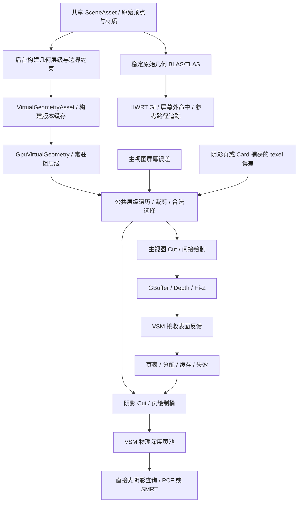

# 虚拟几何、动态无缝 LOD 与 VSM 联合设计

状态：设计提案，尚未实现。初稿：2026-10-26；审查修订：2026-10-27。

本文补充[主渲染管线设计](RASTER_PIPELINE_DESIGN.md)，对应新增的两个目标：类似 Nanite 的运行时几何细节选择，以及类似 UE5 Virtual Shadow Maps 的直接光阴影。二者使用同一个场景、几何层级、裁剪器和间接绘制基础设施。

## 1. 目标与验收语义

| 目标 | 明确的含义 |
| --- | --- |
| 动态 LOD | 相机移动时按投影误差选择局部几何细节，同一物体允许不同区域使用不同层级 |
| 几何无裂缝 | 在支持的输入拓扑与合法层级选择下，相邻区域共享边界保持一致，不出现因简化或量化产生的洞 |
| 切换平稳 | 通过受控屏幕误差、滞回和历史拒绝降低跳变；单独测量轮廓与颜色差异，不以“没有裂缝”代替“看不出切换” |
| VSM | 统一的虚拟阴影地址空间、物理页池、按接收表面请求、页缓存和失效处理 |
| 联合收益 | 主视图与阴影按各自精度选择同一几何层级，避免为每个阴影页重复提交整个高模 |
| 硬件范围 | 首期使用 Compute + VS/PS + ExecuteIndirect；Mesh Shader 查询能力后再优化，不作为最低门槛 |

“运行时动态”首期指静态网格的视点相关 LOD，以及实例刚体变换；蒙皮、Morph Target、任意顶点位移和可破坏拓扑需要另外的层级、边界与缓存更新设计。原始资产已经存在的开口或重叠面不由 LOD 系统自动修复。

公开原理参考 [Nanite SIGGRAPH 2021](https://advances.realtimerendering.com/s2021/Karis_Nanite_SIGGRAPH_Advances_2021_final.pdf) 中的聚类、分组、边界保持简化与层级选择，以及 [Epic 的几何精度说明](https://dev.epicgames.com/documentation/en-us/unreal-engine/nanite-technical-details)。以下结构、参数和实施顺序是本项目方案，不代表直接移植 UE5 实现。

## 2. 共享的数据与执行路径



`SceneAsset` 保留原始几何、材质与实例身份。`VirtualGeometryAsset` 是派生数据，记录源数据 hash、构建器版本与参数；不能成为第二套可独立编辑的场景。`GpuSceneCache` 统一持有原始资源和派生几何租约，实例继续共享一个 mesh 的层级。

当前 [SceneAsset.cs](../DXRDemo/Scene/SceneAsset.cs) 中每个 `SceneMesh` 只有一个材质，[GltfImporter.cs](../DXRDemo/Assets/Importers/GltfImporter.cs) 又会把同一 glTF 逻辑网格的各 primitive 拆成独立 `SceneMesh/SceneInstance`。为落实跨材质 cluster 而不永久锁死拓扑，共享输入必须补充稳定 `LogicalMeshId`、`GeometryInstanceId` 和 primitive material ranges；派生几何以逻辑网格构建、以逻辑几何实例选择，原始 RT 的网格/实例映射保持不变。

同一 `GeometryInstanceId` 下的所有材质桶必须消费同一个合法 Cut 和同一组滞回状态，不能按拆分后的 primitive 各自选择层级。缺少显式身份的旧资产只能按单 primitive 保守构建并保留外边界，不得按名称、相同变换或空间接近程度启发式合并。

`GeometryView` 描述投影、裁剪体积、误差目标和用途。主视图、阴影页、Surface Card 捕获用相同的遍历与绘制接口，分别得到不可变的 `GeometryCut`。一个 frame 中的深度预通道与 GBuffer 必须使用同一个主视图 Cut。

## 3. 离线/后台几何构建

### 3.1 层级生成

1. 校验索引、有限顶点、退化面和非流形边，生成仅用于拓扑的 position identity。不能仅因位置相近就焊接不同表面。
2. 生成叶子 cluster，起点为每个约 64–128 个三角形。几何 cluster 可以覆盖不同材质的三角形，但绘制桶保留 material range，避免为纯材质分割永久锁死几何拓扑。
3. 根据共享边与空间邻接对 cluster 分组。合并组内三角形，锁住组外边界，只简化内部，并计入法线、UV、顶点色的属性误差。
4. 将简化结果重新聚类，记录该组精细几何与粗几何的替换关系，逐层重复，形成多对多替换关系的 DAG。
5. 输出遍历用层级 bounds、替换组 bounds/error、cluster 索引范围、材质范围和边界身份；根几何必须能覆盖整个输入网格。

不能分别对每个 cluster 独立简化后直接混用层级，也不能永久锁定每一层的所有内部边，导致简化到中途完全停止。核心是不改变当前替换组的外部边界，而组内边界可在合并后简化。

构建器优先评估 [meshoptimizer 的 clusterlod 参考实现](https://github.com/zeux/meshoptimizer/blob/master/demo/clusterlod.h)，固定经过验证的版本/提交后在 `Native/GeometryProcessing` 提供窄 C ABI 与离线工具。该项目提供分组边界锁定、层级生成与属性感知简化的参考；接入仍需本项目的拓扑验收、数据格式与确定性构建。具体依赖尚未引入。

### 3.2 边界、材质与精度规则

- 几何位置身份与着色顶点身份分开：UV/法线接缝可以有多个着色顶点，但同一几何边界的坐标和简化约束保持一致。
- 开边界、材质分界和薄片使用显式保护策略；UV、法线、顶点色按属性权重参与简化。MASK、细线、灯罩和接近零厚度表面先采用保守误差或原始几何回退。
- 同一 mesh 的所有层级共享量化原点与步长；首期保留原始 float 顶点，用新增层级索引减少变量。之后压缩时验证边界在解码后仍逐点一致。
- 独立 mesh/实例之间没有天然共享拓扑，首期保留其外边界。跨 mesh 的自动拼接需要作者提供 seam 关系或经过验证的对齐规则，不在位置容差内任意合并。
- 不能在构建粗层级时原地修改所有层级共用的原始顶点，避免污染 LOD0、BLAS 和引用它的其他实例。
- 无法继续简化的组标记为 terminal，允许低简化率；非法/不支持拓扑按 mesh 回退原始几何并记录原因，不能生成不完整的“成功”层级。

误差元数据必须区分几何偏差与属性误差。QEM 代价不能直接当作世界距离或严格 Hausdorff 上界；层级误差按构建方法累计，并对遍历采用单调的保守 bounds。简化器给出的近似误差必须通过独立表面偏差与轮廓测试校准。

## 4. 运行时动态 LOD

### 4.1 合法层级选择

首期误差目标建议为输出分辨率下 1 pixel，并提供可配置质量档。透视主视图的投影估计为：

```text
e_world = e_local × conservativeScaleBound(instanceWorld3x3)
e_pixels ≈ e_world × outputHeight
           / (2 × tan(verticalFov / 2) × max(nearestViewDepth(bounds), near))
```

非均匀缩放或 shear 必须使用变换的保守尺度上界；接近/穿过近裁剪面的 bounds 采用保守细化，不能把负深度代进公式后误判为可用粗层级。正交阴影页使用 light-space world-units-per-texel，局部光透视投影使用对应阴影 mip 的精度。

GPU 遍历结合实例/层级视锥、可选法线锥和 Hi-Z 裁剪，生成绘制列表。双面、镜像、MASK 分别处理，法线锥裁剪不能错误用于双面几何。遮挡裁剪采用保守边界；相机 cut 时禁用不可靠的上一帧遮挡判断。

替换决策在 DAG 的合法替换组上执行，不能让各 cluster 根据自己的距离独立选 LOD。选择结果必须覆盖输入表面一次，不同时输出同一区域的祖先与后代，也不能遗漏依赖邻区。遍历和滞回以 `GeometryInstanceId` 为实例键，跨材质替换组原子发布；先做组级误差/驻留决策，再做不改变层级兼容性的可见性裁剪。

增加组级滞回，例如误差高于 1.1 px 时细化、低于 0.8 px 时允许粗化；这些是实验参数。CPU 参考选择器和 GPU 选择器使用相同的规则与 bounds，验证随机视点和极端缩放下的合法 Cut。

### 4.2 居留、预算与间接绘制

第一版几何层级全量驻留，先证明无裂缝与缩减收益；之后增加几何页请求、异步上传与淘汰。粗层级常驻，只有完整替换组的依赖已驻留且上传 fence 已完成时才允许细化。缺页时继续使用已验证的粗 Cut，不直接丢弃 cluster。

GPU 队列、遍历栈、可见 cluster 和绘制参数都有容量与 overflow 计数。超出预算时提高误差阈值并重新构造合法 Cut，或回退可绘制的粗层级；不能裁掉列表尾部。主视图与阴影的请求共享资源页优先级，但分别限制工作量。

首期 `ExecuteIndirect` 按 PSO/材质/用途分桶，记录 InstanceId、ClusterId、ViewOrPageId 与 indexed draw 参数。使用公共顶点缓冲和派生索引缓冲，不依赖 SM 6.6 的直接 descriptor heap 索引。Mesh Shader 是之后的提交优化，CPU 参考遍历仅用于验证与诊断。

### 4.3 无裂缝与平滑过渡

无裂缝来自构建约束与合法 Cut，不由 TAA、裙边或随机透明过渡保证。首期通过亚像素误差、滞回和受控的历史拒绝达到无明显跳变；轮廓、薄片和高光变化必须实际测试。LOD 区域切换不应重置全屏历史，应输出局部 representation-change mask。

如果验收要求严格的几何连续变化，还需增加 `Geomorph` 阶段：构建时保存精细顶点到粗替换面的映射或渐进 collapse 记录，运行时在替换组内同步变形，且外边界轨迹一致；完成变形后才能原子替换拓扑。不能假设 clusterlod 的层级索引自动提供这些映射。

Geomorph 还需保存上一帧形变状态来生成运动矢量，处理 UV/法线和退化三角形，并证明并发替换组的边界兼容。该项在路线中单列验收；未完成前只能宣称“无裂缝、误差受控的动态 LOD”，不能宣称所有镜头下严格零跳变。

## 5. VSM：直接光阴影的目标实现

### 5.1 地址空间与物理资源

借鉴 UE5 的虚拟阴影分页、方向光 clipmap 和局部光 mip 组织。Epic 的公开实现使用 16K 虚拟分辨率与 128×128 页；本项目把它们作为起始配置，并单独控制实际驻留量。[Epic VSM 文档](https://dev.epicgames.com/documentation/en-us/unreal-engine/virtual-shadow-maps-in-unreal-engine)

| 数据 | 本项目设计 |
| --- | --- |
| VirtualPageKey | LightStableId、ProjectionEpoch、face、clipmap/mip、light-space page XY |
| PageTableEntry | PhysicalSlot、generation、validity、lastUsed、caster representation signature |
| 方向光 | 围绕相机、覆盖半径逐级加倍的 clipmap；覆盖级数按场景尺度与阴影距离确定 |
| 聚光 | 单个透视虚拟映射与 mip 层级 |
| 点光 | 六个 cube face 的虚拟映射与 mip 层级，跨面采样明确转换 |
| PhysicalPool | 普通 committed depth atlas + GPU 页表，软件管理映射；首期不用 D3D12 reserved resource 稀疏映射 |
| Shadow depth | 显式采用常规 light-space Z、clear=1、LESS_EQUAL，独立于主视图反向 Z |

方向光中心按 light-space 页/texel 网格对齐，页 XY 使用稳定的绝对 light-space world-page 坐标，而不是相对当帧 clipmap 中心的坐标。相机平移、旋转、投影 jitter 和 clipmap 中心吸附只改变请求窗口，不增加 `ProjectionEpoch`，因此重叠区域可以复用。只有光方向/光空间基向量、深度范围、页 texel 尺度或投影语义变化才增加方向光的 epoch；局部光的位置、朝向、FOV/范围变化同样使对应投影失效。物理 slot 的复用仍由独立 generation 防护，不能与 ProjectionEpoch 合并。

### 5.2 请求、绘制与缺页处理

1. 从当前深度、VSM 之前的 `TransparentReceiverPrepass` 和需要更新的 Surface Cards 生成 shadow requests，计算光源影响与接收表面的投影精度。预通道只产生接收位置/深度及请求所需语义，正式透明着色在其后复用结果；首期不隐式读取尚未执行的透明最终 pass，也不把上一帧透明数据当作无条件有效的当前帧输入。
2. 请求覆盖滤波 footprint，并压缩去重。每个 light 保留预算内的低分辨率常驻覆盖；方向光优先主视图，局部光按贡献排序。
3. 合并失效信息，分配或复用 PhysicalSlot，生成 dirty-page 列表；新页在清理、绘制完成前不对查询发布为有效。
4. 阴影专用 GeometryView 按页/clipmap 裁剪候选 cluster，以 shadow-texel 误差选择合法 Cut，并生成页绘制桶。
5. 清理并绘制脏页，转换资源状态后发布有效页表，供直接光与透明阶段查询。

投影中的 caster 裁剪按光空间体积执行，不只遍历主相机可见列表；屏幕外物体仍可能向画面内投影阴影。方向光还需为接收区域沿光线方向扩展 caster 查询范围，避免裁掉靠近光源一侧的遮挡物。

页缺失时先查询已完成的粗级覆盖，其次在预算内使用 HWRT 可见性；无 DXR 时保持粗覆盖并报告质量降级。不能把不存在的页采样为“完全受光”。请求超出物理池时提高 mip/误差偏置并重新安排页，保留低精度正确覆盖，记录 overflow 和 fallback 比例。

透明接收表面与 Surface Cards 有独立的低精度请求入口，不能只分析主视图 opaque depth。Hit Lighting 的任意屏幕外查询仍允许 HWRT；无需为了每个一次性 RT 命中都分配一整张高精度阴影页。

### 5.3 没有完整 Nanite 时的页绘制方式

页池采用固定 atlas viewport，由顶点着色器按 PhysicalSlot 映射 page-local clip coordinates；输出对应的 `SV_ClipDistance` 裁剪到该页的有效区域，避免大三角形覆盖邻页。不能只偏移 viewport 坐标却省略逐页裁剪，也不能假设 ExecuteIndirect 能设置 viewport/scissor。

脏页列表在 GPU 生成，因此首期用间接程序化 quad 的深度写入清理脏 slot，再绘制 caster；不为获取 clear rects 或 viewport 列表逐帧读回 CPU。Clear PSO 与 caster PSO 分开，clear 使用 ALWAYS，caster 使用 LESS_EQUAL。

一个全 atlas depth pass 处理按状态分桶的页绘制任务。每个任务只提交与该页相交的 cluster，而非完整原始 mesh。可先用 CPU 已知页列表建立正确性探针，但正式路径不能把“每页一次 CPU 全场景绘制”作为可扩展方案。

128 texel 是页内部尺寸；小 guard 区用于局部过滤，宽 footprint/SMRT 的每次跨页访问仍需页表查找和相应请求，不能靠固定 guard 覆盖任意半影。alpha-mask 阴影也使用共享 UV/alpha 规则和与阴影 texel 相符的纹理 LOD。

### 5.4 缓存失效

| 变化 | VSM 处理 |
| --- | --- |
| 相机平移、正常转动、投影 jitter、clipmap 中心吸附 | 只更新请求窗口，不增加 ProjectionEpoch；请求新可见页并复用重叠的绝对 light-space world-page |
| 光源颜色或强度改变 | 阴影深度保持；直接光与 GI 光照缓存按 LightingRevision 更新 |
| 光源位置、方向/光空间基向量、深度范围、页 texel 尺度或投影语义改变 | 该光源 ProjectionEpoch 改变，旧深度无效 |
| 光源 source radius / angular size 改变 | 更新滤波与请求 footprint；投影未变时可复用已有深度 |
| caster 增删或实例变换 | 同时投影旧 bounds 与新 bounds，失效两者覆盖的页，避免旧阴影残留 |
| alpha cutoff、双面/剔除、位移等遮挡语义改变 | 失效受影响 caster 页 |
| 材质颜色、粗糙度、自发光改变而遮挡不变 | 保留深度；只更新光照/材质缓存 |
| 阴影几何表示细化或驻留替换 | 根据 page 的 caster dependency/signature 重绘有关页 |
| SceneEpoch、物理 slot 淘汰/复用 | 清除有效标志，检查 generation 后重新发布 |

不能因为主视图 LOD 每帧变化就清空所有阴影页。阴影 Cut 自己按 page 精度决定，只有实际影响页的几何表示改变才失效。首期场景以静态物体为主，使用一层缓存；后续大量动态物体出现后再评估静态/动态深度拆层，并计入额外显存与合并成本。

### 5.5 软阴影与统一查询接口

先用硬阴影/PCF 验证分页正确性，再接入类似 SMRT 的采样：沿指向光源的若干路径在阴影映射中做深度测试，形成接触处硬、远处软的半影。它采样阴影深度，不需要 DXR；DXR fallback 通过相同 ShadowQuery 接口提供可见性。

太阳直接复用 SunLightSettings 的角直径；glTF 的理想点/聚光默认 source radius=0，额外软阴影半径放在以 LightStableId 索引的 LightShadowSettings，不悄悄改变原始灯光能量或假装 glTF 自带面光源参数。

SMRT 的近似、投影第一层深度、重叠遮挡和过大半影都需要单独验证；它不等于几何光追的多层可见性。ray count、samples per ray、filter radius 和时间滤波分别预算，不能依靠无限增加 taps 修复缺页。

`ShadowQuery` 返回 Visibility、Validity、EffectiveResolution 和 FallbackKind。屏幕直接光、透明、Surface Lighting 与 Hit Lighting 消费相同结果契约，但可以指定不同质量和延迟容忍度。路径追踪继续精确采样几何可见性，其物理光传输不依赖 VSM 缓存。

## 6. 与 Lumen 式 GI 和路径追踪的一致性

原始 VB/IB 和稳定材质身份继续由 RayTracingScene 共用。首期 BLAS 保留原始高精度三角形，不随屏幕 LOD 每帧重建；光栅派生层级共享源顶点，并有自己的层级索引与 metadata。

这意味着自适应光栅、阴影与 RT 可以选取不同精度，但它们来自同一资产版本。通过表面偏差上限、屏幕几何匹配与必要的 ray-origin offset 控制差异；不能无限增大 bias 掩盖错误自遮挡。未来若引入 RT proxy，需要独立的误差预算、BLAS 版本与薄墙/反射测试，不默认使用最粗根层级。

**执行门槛。** M1.5/M4 的硬件 GI 与反射正确性基线固定主视图 LOD0。简化光栅表面与 LOD0 BLAS 不共面时，光线起点可能落在 RT 表面两侧，bias 无法同时普遍避免接触处错误自遮挡和薄墙漏光，representation-change mask 也只能处理历史，不能修复几何差异。混合表示因此是独立质量档：必须明确并验证起点重定位、命中拒绝或匹配 RT proxy 的方案，分别测量错误自遮挡与漏光，并覆盖薄墙、近接触、掠射和 LOD 往返切换；门槛未通过时，启用硬件 GI 的主视图保持 LOD0，M2 的动态 LOD 仍可在纯光栅/VSM 路径独立验收。

保留全精度 BLAS 时，原始 RT 几何仍占用常驻显存；后续 streaming 首先控制派生光栅几何的驻留，不能因此声称整套光追场景已经支持超显存规模。要进一步扩展总场景量，需要单独设计 RT 几何流送/代理与 AS 更新预算。

Surface Cards 使用捕获分辨率选择几何 Cut，而不直接复用当帧主视图 Cut；稳定的材质捕获不应随着相机 LOD 阈值频繁失效。屏幕运动矢量区分真实物体运动和几何表示切换；representation-change mask 用于局部 GI/反射/TAA 历史拒绝。

VSM、Surface Cache、世界探针、几何驻留页池共享设备预算管理，但分别维护自己的键、有效性、失效原因与统计。不能把 VSM 深度页和 Surface Lighting 页混为一种缓存。

## 7. 帧调度、显存与性能

主路径顺序为：发布已完成上传 → 确定主视图 Cut → Depth/GBuffer、预算内 Card 材质捕获与 TransparentReceiverPrepass → 合并阴影接收请求与失效 → VSM 分配/脏页几何选择 → 页清理/绘制 → 直接光与 Surface Lighting 更新 → GI/反射/透明正式着色 → 共享重建/输出。

Surface Lighting 更新在 VSM 页可查询后执行；临时未覆盖的屏幕外采样可用 HWRT。所有页表/间接参数的 UAV 生产消费、depth pool 的写入读取、以及不同用途的 descriptor 绑定都由 PassScheduler 声明和排序。物理页映射更换要保护仍被已提交帧使用的资源，GPU generation 检查不能代替 fence 生命周期。

| 预算示例 | 设计起点，尚未测量 |
| --- | --- |
| VSM physical pool | 2048 页；每页 128² 内部 texel + 2 texel guard，各 slot 132² D32，约 136 MiB |
| 页池排布 | 64×32 slots，对应 8448×4224 atlas；另算页表、请求列表与绘制元数据 |
| 扩展到 4096 页 | 同样 guard 下约 272 MiB，不能仍按 128 MiB 计费 |
| 几何派生数据 | 单独统计所有 LOD 索引、cluster/group metadata、root 常驻和未来 streaming pages，不预设与原始几何等大 |
| 更新限制 | 每帧新增/失效页、页绘制三角形和 draw/dispatch 数分别限额，必须保证粗级覆盖与合法几何 Cut |

Epic 明确提醒了非 Nanite 几何的 VSM 绘制成本。本项目因此把共享 cluster 层级与页绘制分桶安排在 VSM 正式接入之前；仅实现 cluster LOD 仍不保证具有 UE5 的微三角形吞吐。[VSM 性能说明](https://dev.epicgames.com/documentation/en-us/unreal-engine/virtual-shadow-maps-in-unreal-engine#improvingnon-naniteperformance)

VSM 主要依赖缓存和细粒度几何裁剪。Bistro 的单帧大转身、连续改变太阳方向、多盏大范围点光会触发明显不同的成本，应单独做压力曲线。不能把静止镜头的缓存命中结果当作整体帧率。

监测 `VisibleClusters`、`SelectedTriangles`、`LODGroupsChanged`、`GeometryOverflow`、`Requested/Allocated/Cached/Dirty/RenderedPages`、`PageMiss`、`CasterTrianglesPerPage`、`ShadowDepthTime`、`ShadowProjectionTime`、`ShadowFallbacks`，以及 CPU 提交与整帧 p50/p95。

## 8. 文件与实施边界

```text
Native/GeometryProcessing/          # 固定版本的层级构建依赖和 C ABI
tools/GeometryBake/                 # 打包场景的离线构建/验证入口
DXRDemo/Geometry/
  VirtualGeometryAsset.cs           # 派生资产、group DAG、构建版本
  VirtualGeometryBuilder.cs         # 后台构建与取消
  VirtualGeometryRenderer.cs        # GPU 遍历、合法 Cut、绘制桶
  GeometryResidency.cs              # 后续几何页驻留，不重复场景管理
DXRDemo/Lighting/Shadows/
  ShadowSystem.cs                   # 查询/调度，持有一个选中的后端
  VirtualShadowMaps.cs              # clipmap、local views、生命周期
  ShadowPageCache.cs                # 页表/分配/失效/预算
  ShadowPageRenderer.cs             # cluster-page binning 与页绘制
DXRDemo/Shaders/Geometry/            # 层级遍历、裁剪、间接绘制
DXRDemo/Shaders/Shadows/             # feedback、page、projection、SMRT
```

结合主设计，先抽共享层并完成原始几何光栅基线，再用 LOD0 + CSM 做最小 HWRT GI/Hit Lighting 垂直切片，随后交付几何层级、GPU LOD 与 VSM；完整硬件 GI 和 Surface/World 缓存沿同一共享接口继续推进。CSM/传统局部阴影作为基线与设备/预算降级的一个 ShadowBackend，不为各调用者维护独立阴影控制或重复光照实现。

几何 out-of-core streaming、严格连续 Geomorph、Mesh Shader、微三角形软件光栅分别作为后续阶段；动态无裂缝 LOD 的首个版本不依赖它们，也不据此宣称具备完整 Nanite 的规模能力。

## 9. 必须通过的验证

1. **拓扑与身份**：构建器校验相邻替换边界的有向线段/顶点身份、material seam 和 terminal 覆盖；随机合法 Cut 不新增开边，不同时绘制祖先/后代。`LogicalMeshId/GeometryInstanceId` 在导入、实例共享和管线切换后保持稳定，同一逻辑实例的跨材质桶原子消费同一切换决策；缺身份资产只能退化为单 primitive。
2. **视点**：缓慢跨阈值、快速推拉、近裁剪穿越、极端非均匀/镜像变换、相机 cut 下无洞；固定误差阈值并报告轮廓偏差、三角形数量与切换频率。
3. **精度**：LOD0 与原始资产一致，所有层级的边界坐标一致；启用量化后再次验证，不能只检查量化前数据。
4. **驻留/预算**：模拟缺页、上传延迟、显存紧张和遍历 overflow，持续保留完整粗 Cut，不出现洞或非法索引。
5. **分页阴影**：tile 边缘、cube face 接缝、clipmap 边界和 PCF/SMRT 跨页无串页；已知几何与同分辨率完整 shadow map 对照，区分页错误和几何 LOD 误差。相机平移与中心吸附不得增加 ProjectionEpoch，重叠 world-page 应命中缓存；光方向/光空间基向量、深度范围或 texel 尺度改变必须使旧页失效。
6. **失效**：静止时脏页下降；相机 jitter、灯光强度/颜色变化不重绘深度；太阳转向、caster 移除/移动、alpha 改变及时消除旧阴影。
7. **离屏与透明遮挡**：屏幕外 caster 向画面内正确投影；TransparentReceiverPrepass 在当前帧 VSM 请求前完成，正式透明着色复用结果且不存在对后续 pass 的隐式依赖；透明和 Surface Cards 在主 opaque depth 未覆盖的位置仍得到有效阴影或明确 fallback。
8. **三种几何用途一致性**：先以主视图 LOD0 建立 GI/反射基线，再独立测试自适应主表面、VSM 与原始 RT 几何的组合。薄墙、近接触、掠射和 LOD 往返切换分别统计错误自遮挡与漏光，不能只靠 bias 或历史 mask 通过；切换主视图 LOD 不全量清空 VSM/GI，混合表示门槛未过时硬件 GI 回退主视图 LOD0。
9. **规模收益**：Kitchen/Bistro/Rainy Corner 同相机路径对照全精度与自适应模式；同时报告 GPU 时间、CPU 提交、几何量、页更新、透明预通道和显存，不能仅用减少的三角形数量宣称加速。

上述主视图 LOD0 与缺身份时的单 primitive 回退是审查后增加的正确性门槛，不是可选优化；它们用于把虚拟几何/VSM 的独立验收与尚未解决的混合表示风险隔离开。

目前仅完成 2026-10-27 的设计审查修订，没有实现或验证上述运行时系统。
